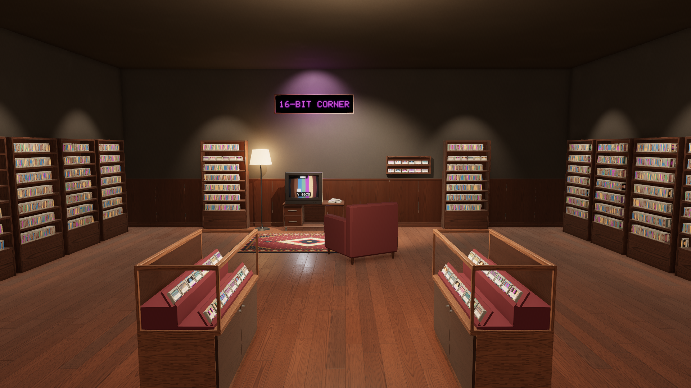

# Retroverse

Retroverse turns an [ES-DE](https://es-de.org/) game collection into an explorable 3D world: a warm retro-gaming
museum whose rooms, shelves, cartridges and CRT televisions are generated from the library itself. Pick up a
cartridge, read its card, watch its preview on a CRT and launch the emulator, or skip the walk and use the quick
launcher.

It is a native Windows application written in C++20 with OpenGL 4.5 and SDL3, without a game engine. Retroverse
does not emulate anything and never copies or rewrites the collection: ROMs, `gamelist.xml` metadata and media
stay where ES-DE keeps them.

> **Status:** milestones M0 (native foundations) and M1 (the ES-DE catalog and the launcher) are done but for their
> manual sign-offs, and so is the I3 vertical slice (milestone M2): Retroverse reads your ES-DE library in place and
> generates one room for its SNES games, one cartridge per title with its real cover, which you can walk up to, pull
> out, inspect, read about and launch, while the CRT plays the selected game's clip. Gate B's automated checks pass
> ([docs/testing/gate-b.md](docs/testing/gate-b.md)); its manual session awaits the user. Multi-room worlds come next
> (I4, milestone M3). See [docs/roadmap.md](docs/roadmap.md).



*Golden G02s: the room generated for a 2,000-title test fixture (invented titles, generated covers) from its doorway at
1920x1080. Everything in it is procedural and original: the room, the shelves, display cases and furniture, the CRT,
the cartridges' labels and spines, the posters and the sign, and the wood, plaster, rug, metal and plastic surfaces.
The checklist of style.md section 26.2 for the room goldens is in [docs/testing/gate-b.md](docs/testing/gate-b.md),
for the M0 test room (golden G01) in [docs/testing/gate-a.md](docs/testing/gate-a.md).*

## What M0 delivers

- **A native foundation:** SDL3 window and OpenGL 4.5 core context with debug output, a frame loop that runs
  interactively or for a fixed number of frames (automation), logging, a command line with documented exit codes.
- **Input:** keyboard, mouse and gamepads (hot-plug) through a remappable action map; first-person walking with
  capsule collision against walls and furniture; scripted input and fixed time steps for reproducible runs.
- **Rendering:** a forward PBR renderer with batching and instancing; the key light's shadow map, a depth pre-pass and
  screen-space ambient occlusion; linear HDR with localized bloom, vignette, ACES tonemapping, dithering and FXAA;
  CRT screens with curvature, scanlines and an aperture grille; procedural PBR surfaces generated at startup.
- **Content:** glTF models with sockets (`Anchor_*`, `ScreenSurface`, `ColliderProxy`), procedural prefabs (room shell,
  shelf, cartridge, CRT, TV cabinet, console, poster, rug, lamps, armchair), material presets, scene description files.
- **Tools:** a Dear ImGui developer overlay (stats, camera, lights, materials, rendering switches, log, scene),
  `retroverse-asset-preview` to inspect a model, a manifest or a prefab (bounds, sockets, screens, statistics, view
  modes), `retroverse-screenshot-diff` to compare screenshots with golden images.
- **Verification:** more than 500 unit tests (GPU-free, plus the SDL platform layer), GPU smoke tests that run the
  executables on every reference scene and check their reports and screenshots (frame statistics, OpenGL errors, the
  sRGB, bloom and FXAA self-checks, the shadow, the ambient occlusion, the overlay, the asset preview, the golden
  image), and `scripts/gate.ps1`, which builds the Debug, RelWithDebInfo and Release configurations and runs the unit
  tests, the smoke tests, the I1 spike checks and the golden comparison of Debug and Release.

## Requirements

- Windows 10/11 x64, a GPU with OpenGL 4.5 core support.
- Visual Studio 2026 with the "Desktop development with C++" workload (MSVC 14.5x, bundled CMake and Ninja).
- [vcpkg](https://github.com/microsoft/vcpkg) cloned locally and bootstrapped, with `VCPKG_ROOT` pointing at it (set
  for the user, not only in a shell: `scripts/dev.ps1` keeps it through the Visual Studio developer environment, which
  would point it at Visual Studio's bundled vcpkg; ADR-0007). The manifest pins the baseline in `vcpkg.json`; update
  the clone if that commit is missing.

## Build and test

```powershell
./scripts/build.ps1                                # Debug (msvc-x64-debug); the first run installs vcpkg packages
./scripts/test.ps1                                 # unit tests
./scripts/test.ps1 -Preset msvc-x64-debug-gpu      # unit tests and GPU smoke tests
./scripts/gate.ps1 -Gate A                         # Debug, RelWithDebInfo, Release builds; tests of Debug and Release
./scripts/gate.ps1 -Gate B                         # Gate A, every golden, the I3 checks and the benchmarks
```

Other presets: `msvc-x64-relwithdebinfo`, `msvc-x64-release` (no developer overlay, assets deployed next to the
executable), `msvc-x64-profile` (Tracy). The scripts enter the Visual Studio developer environment on each call; see
[CLAUDE.md](CLAUDE.md) for every command and option.

## Run

```powershell
./build/msvc-x64-release/bin/retroverse-cli.exe library create  # once: find ES-DE and record the library
./build/msvc-x64-release/bin/retroverse-cli.exe import          # import its catalog (again to refresh)
./build/msvc-x64-release/bin/retroverse.exe                     # your collection's building: the ground floor's lobby
./build/msvc-x64-release/bin/retroverse.exe --start-room room:snes  # in your SNES games' room (until the elevator)
./build/msvc-x64-debug/bin/retroverse.exe --scene m0_testroom   # the M0 test room; Esc releases the mouse, again quits
./build/msvc-x64-debug/bin/retroverse.exe --scene material_test
./build/msvc-x64-debug/bin/retroverse.exe --model path/to/model.glb
./build/msvc-x64-debug/bin/retroverse-asset-preview.exe prefab:crt
./build/msvc-x64-debug/bin/retroverse.exe --help
```

Controls: WASD or the left stick walk (Left Shift sprints), the mouse or the right stick look around; E, a click or
the pad's A takes the cartridge you point at (Focus, then Inspect with its card: Avvia, Vedi media, Informazioni);
Tab (gamepad Y) opens the quick catalog; Esc (gamepad B) leaves one level, F1 toggles the developer overlay, F5
reloads the shaders, F12 saves a screenshot, Alt+Enter toggles fullscreen.

## Repository layout

| Path | Content |
|---|---|
| `src/` | Engine-free application code, one library per module (see [docs/architecture.md](docs/architecture.md)) |
| `assets/` | Shaders, material presets, prefab manifests, asset registry, reference scenes and their golden screenshots |
| `tests/` | Catch2 unit tests (GPU-free and SDL platform layer), test helpers, scripted input runs, GPU smoke tests |
| `tools/` | Developer tools (asset preview, screenshot diff) and `retroverse-cli`, the ES-DE catalog from the command line (I2) |
| `spikes/` | I1 measurement executables (video, product UI, emulator return) and their tests; reports in `docs/spikes/` |
| `scripts/` | Build, test and gate scripts (PowerShell), test model generator (Python) |
| `third_party/` | Vendored code not available through vcpkg (generated glad loader, RmlUi's SDL3 and OpenGL 3 backends) |
| `docs/` | Roadmap, architecture, decision records, spike reports, testing notes |
| `specification.md`, `style.md`, `example.png` | Product specification, art bible and concept (Italian) |

## License

Retroverse source code is released under the [MIT License](LICENSE). Third-party libraries keep their own licenses,
listed with their versions and notices in [docs/third-party.md](docs/third-party.md).
Retroverse ships no ROMs, BIOS files, cover art or other copyrighted game content.
