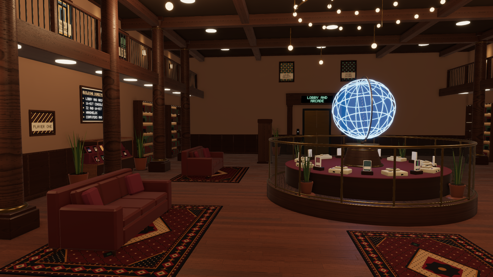
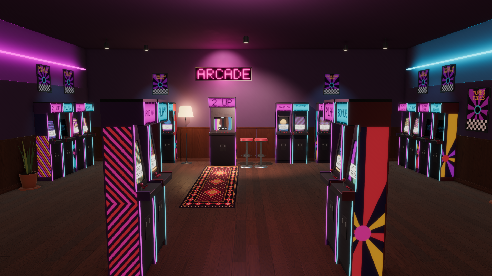
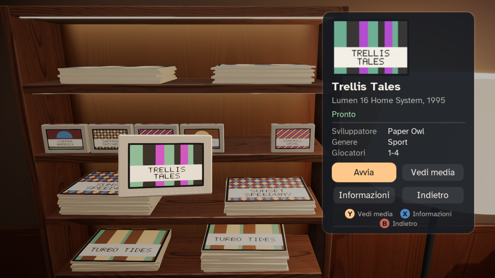
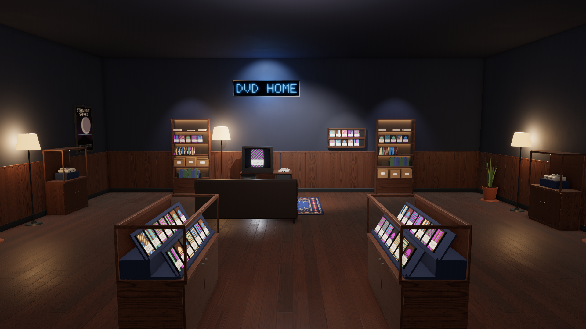

<p align="center">
  <picture>
    <source media="(prefers-color-scheme: dark)" srcset="assets/branding/retroverse-lockup.svg">
    
  </picture>
</p>

<p align="center">
  <b>Your retro game collection, as a building you can walk through.</b><br>
  A native Windows frontend for <a href="https://es-de.org/">ES-DE</a> that turns your library into a warm 3D museum
  of rooms, shelves and CRT televisions.
</p>

<p align="center">
  <a href="#quick-start">Quick start</a> ·
  <a href="#controls">Controls</a> ·
  <a href="#where-it-stands">Where it stands</a> ·
  <a href="#for-developers">For developers</a> ·
  <a href="docs/roadmap.md">Roadmap</a>
</p>



## What it is

Retroverse reads the collection you already keep in ES-DE and builds a world from it. Every system gets a room, every
game stands on a shelf with its real cover, and the room's CRT plays its clips. Walk up to a game, pull it out, turn it
in your hands, read about it and press **Avvia**: the emulator starts, and when you quit you are back in the room where
you left off. If you would rather skip the walk, the quick catalog finds any title in a few keystrokes.

- **A building made from your library.** There is a floor for each console generation, plus one for handhelds and one
  for computers. An elevator joins them, and its directory also lists your favourites and recent games. The arcade
  systems share an arcade room, and the small systems share a room on their floor.
- **Deterministic and yours.** The same library always produces the same building. A game added later finds a free spot
  without moving anything, and the editor lets you move, swap and pin games and furniture.
- **Screens that play.** CRTs, secondary TVs and arcade cabinets play the clips ES-DE scraped, with spatial sound, CRT
  presets and fallbacks down to a generated title card.
- **Daily use from the couch.** Everything works from a gamepad: a first-run wizard, settings, remapping, an on-screen
  keyboard, emulator choices with launch tests, play statistics and a library that refreshes itself when ES-DE adds
  games.
- **VR.** Put on an OpenXR headset (Meta Quest over Link or Air Link, SteamVR) to walk the building and play the
  launched game on the room's CRT.
- **Read-only and brand-free.** Retroverse never copies, moves or rewrites your ROMs, `gamelist.xml` files or media. It
  ships no ROMs, BIOS files, cover art or trademarks. The consoles' real names and logos are read at runtime from your
  ES-DE themes and never stored in the repository.

<table>
  <tr>
    <td></td>
    <td></td>
  </tr>
  <tr>
    <td></td>
    <td></td>
  </tr>
</table>

<sub>These are the golden screenshots the tests compare against. They use invented test fixtures: every title, cover,
poster and label is generated, and so are the rooms, the furniture and their surfaces.</sub>

## Quick start

You need **Windows 10 or 11 (x64)**, a GPU with **OpenGL 4.5**, and an **ES-DE** installation with a scraped
collection. There is no installer yet, so build Retroverse from source (see [Build](#build)), then run:

```powershell
./build/msvc-x64-release/bin/retroverse.exe
```

The first start opens a wizard, which you can drive from the pad. It finds ES-DE, previews your library and imports it.
Planning the building takes a few seconds. After that you start in the ground floor's lobby, and covers load as you
walk. Later starts show the stored building at once.

Other ways to start:

```powershell
./build/msvc-x64-release/bin/retroverse.exe --start-room room:snes   # straight into one system's room
./build/msvc-x64-release/bin/retroverse.exe --vr                     # in the headset
./build/msvc-x64-release/bin/retroverse.exe --data-dir D:\rv         # keep Retroverse's own data in a folder you choose
./build/msvc-x64-release/bin/retroverse.exe --help                   # every option
```

`retroverse-cli` does the same from a terminal: `library create` and `import` set up the library without the wizard,
and `--help` lists the rest. Retroverse writes only to its own data directory, never into ES-DE's folders.

## Controls

| | Keyboard and mouse | Gamepad |
|---|---|---|
| Walk, sprint | WASD or arrows, Left Shift | Left stick, click it |
| Look around | Mouse | Right stick |
| Take, inspect, choose | E or left click | A |
| Back one level | Esc | B |
| Elevator directory (floors, rooms, favourites, recent) | M, or E facing the elevator | Back / Select |
| Quick catalog | Tab | Y |
| Menu (settings, emulators, statistics, library) | F10 | Start |
| Fullscreen, screenshot | Alt+Enter, F12 | |

Every binding can be changed in the settings screen, and the hint bar at the bottom always shows the current ones.

## Where it stands

Retroverse is a personal project that grows in iterations, each closed by a gate of automated checks and a session
played by hand ([roadmap](docs/roadmap.md)).

- **Done:**
  - native foundations;
  - the ES-DE catalog and launcher;
  - the first room;
  - the whole building and its styling;
  - customization;
  - screens and media;
  - VR through OpenXR.
- **In progress:**
  - daily use (M5, part 1): the menu, wizard, settings, emulators, controls, statistics, file watcher and library
    screens are in, and the controller-only Gate Pad comes next;
  - the consoles' real identity and every emulator in VR (I11): names and logos are in the UI, and logos on the room
    signs come next.
- **Ahead:** performance work, hero assets, then an installer, a portable build and the first release.

## For developers

Retroverse is written in C++20 with OpenGL 4.5 core and SDL3, with no game engine. It is split into small libraries:
the catalog, the world generator and the launcher run without a GPU and are unit tested, and the renderer, UI and VR
layers sit on top ([architecture](docs/architecture.md)).

### Build

Requirements:

- Visual Studio 2026 with the "Desktop development with C++" workload (MSVC 14.5x, bundled CMake and Ninja).
- [vcpkg](https://github.com/microsoft/vcpkg), cloned and bootstrapped, with `VCPKG_ROOT` set for the user, not only in
  a shell. The baseline is pinned in `vcpkg.json` ([ADR-0007](docs/decisions/ADR-0007-vcpkg-clone.md)).

```powershell
./scripts/build.ps1                                  # Debug; the first run restores the vcpkg packages
./scripts/build.ps1 -Preset msvc-x64-release         # Release, the one to play with
./scripts/test.ps1                                   # unit tests
./scripts/test.ps1 -Preset msvc-x64-debug-gpu        # plus the GPU smoke tests
./scripts/gate.ps1 -Gate D                           # build matrix, tests, golden screenshots, benchmark path
```

The scripts enter the Visual Studio developer environment for you. Don't call `cmake`, `ctest` or `ninja` directly.

### Where to read next

| Document | What it covers |
|---|---|
| [CLAUDE.md](CLAUDE.md) | The working guide: commands, layering, conventions and safety rules |
| [docs/reference/](docs/reference/) | Build and test, running the app, visual verification, the CLI, the module layout |
| [docs/architecture.md](docs/architecture.md) | Modules, the frame pipeline and testing |
| [docs/roadmap.md](docs/roadmap.md) | Iterations, gates and the working method |
| [docs/decisions/](docs/decisions/) | Architecture decision records (binding) |
| [docs/branding.md](docs/branding.md) | The logo and how to use it |
| [specification.md](specification.md), [style.md](style.md), [example.png](example.png) | Product specification, art bible and the approved concept (Italian) |

### Repository layout

| Path | Content |
|---|---|
| `src/` | The application, one library per module, `app` as the composition root |
| `assets/` | Shaders, materials, prefabs, UI documents, the logo, the asset registry, the reference scenes and their goldens |
| `tests/` | Catch2 unit tests, GPU smoke tests, scripted input runs, original fixtures |
| `tools/` | `retroverse-cli`, the asset preview and the screenshot diff |
| `scripts/` | Build, test and gate scripts, Python oracles, the logo's generator |
| `third_party/` | Vendored code not available through vcpkg |
| `docs/` | Roadmap, architecture, decisions, step notes, testing and reference |

## License

The Retroverse source code is released under the [MIT License](LICENSE). Third-party libraries keep their own
licenses, which are listed with their versions in [docs/third-party.md](docs/third-party.md). Retroverse ships no
ROMs, BIOS files, cover art or other copyrighted game content.
