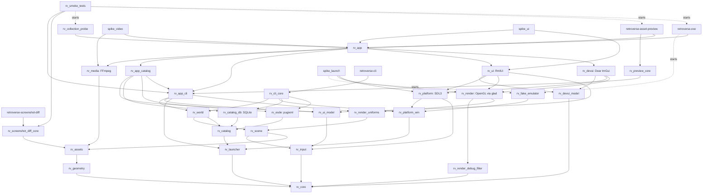

# Architecture

This document describes the code that exists today. The target architecture is in `specification.md` §15.

## Modules

| Module | CMake target | Responsibility | May depend on |
|---|---|---|---|
| core | `rv_core` | Errors (`rv::Expected`), logging (`FailureStreak`: which failures of an operation retried every frame to log; the in-memory recent lines with a message count and `parseLogLine` for the overlay; the console sink on stdout, or on stderr with a level of its own for `retroverse-cli`), paths, frame clock, AABB/ray math, sRGB color helpers, file I/O (also `readFileShared`, for files another program rewrites, through `\\?\` paths, `extendedLengthPathBelow`, which reopens a walked name exactly, and since I2 step 11b `SharedFileReader`, positioned reads of a file opened for reading only with full sharing, its size and time from the handle, and `listedFileFacts`, a file's size and time as a listing gives them), file change polling (`FileWatchSet`), JSON, command line parsing; since I2 (ADR-0008): `ErrorCode`s `Unavailable` and `Conflict` with Windows errors mapped to them (`system_error.hpp`: a missing drive is unavailable, a locked file a conflict) and `Cancelled` (an operation stopped on request), SHA-256 (`sha256.hpp`), file-system case folding (`case_fold.hpp`: `LCMapStringEx` with the invariant locale's upper case, code unit by code unit as NTFS and exFAT compare names, the casing table's version; the same table's lower case, `invariantLowerCase`, for the catalog's sort keys), UTF-8 validation and conversions that never throw, and the Windows-1252 reading of text that is not UTF-8 (`utf8.hpp`), UTC ISO-8601 times (`time.hpp`), paths read from files resolved against their folder without traversal (`relative_path.hpp`: `OutOfRange` outside it, `InvalidArgument` malformed), the tree walker (`tree_walk.hpp`: `FindFirstFileExW` on `\\?\` paths, entries sorted by their UTF-8 names, links followed unless they loop, errors as entries, a folder that cannot be listed `Unavailable`, cancellation), `Paths::databaseDir`, `pathIsWithin` and the data-directory guard `checkUserDataDirectory` (links, junctions, subst and mapped drives resolved), the system probe port (`system_probe.hpp`: registry strings, keys and sub-keys, files and wildcards, the home, System32 and Windows folders, PATH; the App Paths and uninstall-entry rules over it), shared by `rv_launcher` and `rv_esde`; since I3 step 0b (ADR-0010 §7-§9, ADR-0011 §6): seeds (`seed.hpp`: `deriveSeed`, SHA-256 of the NUL-separated tuple `rv-seed/1`, parts..., integers as decimal digits, the first 8 bytes big-endian), the random generator (`random.hpp`: `Random`, SplitMix64 `splitmix64/1` with its own `below`, `between`, `unit` and `shuffle`), canonical JSON (`canonical_json.hpp`: keys by code point, integers only, top-level arrays one element per line, a final LF; `canonicalJsonDigest`; `parseCanonicalJson` refuses any other text), the worker pool (`worker_pool.hpp`: `WorkerPool`, `min(6, hardware threads - 3)` threads below normal priority, a bounded queue that refuses when full, priorities, cancellation by `JobGeneration`, a 2 s shutdown bound), rotating backups (`backups.hpp`: `backUpFile`, the newest 10), `writeFileAtomic` flushed before a write-through rename; since 0d the main thread's CPU sections (`cpu_timers.hpp`: `CpuTimers`, `mainThreadCpuTimers`, `CpuSectionScope`, `summarizeDurations`, nearest rank); since 13r the in-memory log lines and their count read under one lock (`logLinesSince`, one `MemorySink`, a generation per configuration) | glm, spdlog, nlohmann-json, tl-expected |
| geometry | `rv_geometry` | CPU meshes (`MeshData`, 48-byte `Vertex` with glTF tangent space), sockets (with their size as placed, `socketSize`), procedural mesh builder (box uvs in meters along each face's longer side, `BoxUv::GrainMeters`, for surfaces with a grain; chamfered boxes bevelled around chosen faces only, so that boards keep square bottom edges) and procedural prefabs with their collision boxes, uv scale of a surface, also as drawn with a transform (`uvMetersPerUnit`); since I3 step 1b the collection's prefabs (`display_case` with two tilted face-out levels behind glass, the featured `wall_shelf`, the shelf dressing `storage_box`, `magazine_stack` and `bookends` sized to a level and varied by a seed, the cartridge's optional `spineLabel`, `shelf`'s display levels and front inset for the hero-wall and side-wall modules), slot and level sockets (`Slot_<level>_<index>`, `Level_<level>`; `parseSlotId`, `parseLevelId`, `slotLevels`) and how items stand in them (`SlotFacing`, `slotSizeFor`, `slotItemTransform`) | core |
| input | `rv_input` | Device-neutral codes, logical actions (the 3D world's and, since I2 step 6, the sixteen `ui_*` actions of the product UI, `isUiAction`: directions, the stick's axes `ui_nav_x`/`ui_nav_y`, pages, Home and End, activate, back, media, info, the filters), action maps (with per-action user overrides), per-frame `ActionState`, input scripts for automated runs (`InputScript`, `InputScriptPlayer`) | core |
| assets | `rv_assets` | Image decoding/encoding, glTF loading, prefab manifests, material presets (texture files, procedural textures, the `crt` block of screens), shader source loading, procedural test patterns (cover placeholders, color bars, sign lettering; sized to their surface: `patternLongSideFor`, `patternSizeForAspect`), procedural PBR surfaces (`surface_textures.hpp`: wood, plaster, rug, metal, plastic), the GLB writer (`glb_writer.hpp`: the asset preview's CRT-like fixture, the models of the loader tests); a model lists the files it references (`ModelData::externalFiles`); since I3 step 1b the prefab families (`assets/manifests/families.json`, `prefab_resolver.hpp`: `resolvePrefab`, the requested manifest when usable, else the family's generic manifest, else its procedural prefab, one warning each: style §21's object fallbacks); since step 5 the collection's cover and label pipeline, GPU-free and safe on several workers (ADR-0011 §5-§7: `cover_fit` (fit or bands, never stretched, the 8% crop bound, the dominant colour), `mip_chain` (exact sRGB codes, mips in linear light), `bc1` (stb_dxt, edge-padded blocks, a reference decoder), `text_raster` (stb_truetype on the bundled fonts, loaded only when their SHA-256 matches the registry), `collection_labels` (spines and generated front labels, contrast at least 4.8:1), `rvtex` (the layer file, `kCoverPipelineVersion`) and `derived_texture_cache` (`<user data>/cache/textures/<library id>`: entries named without the source, served while it is out of reach, invalidated by its size and time, trimmed to 512 MiB)) | core, geometry, fastgltf, stb |
| scene | `rv_scene` | Camera, first-person controller and viewpoints (`frontViewpoint`: where a walker stands to look at an object, framed in a part of the view, `ViewArea`; `aimAt`: the orientation that shows a point at the center of a view area), the orbit camera of the asset preview (`OrbitController`: orbit, pan, zoom, auto-rotation, bounds framed in a view area, clip planes that follow the distance), lights, render items, draw passes and the batching plan (`BatchPlanner`: frustum culling, opaque/mask/blend passes, blend back to front; the world bounds of what a shadow map draws, `shadowCasterBounds`), scene description files, scene content assembly (`buildSceneGeometry`: meshes shared by objects of the same shape, resolved materials, scene textures, glTF models through a `ModelLoader`, sockets, bounds and colliders per object), debug lines (`DebugLines`, `addSceneBoundsLines`, `addSceneSocketLines`), collision (`CollisionWorld`, `buildCollisionWorld`); since I3 the 80-byte instance record (`instance_data.hpp`, step 0c: `InstanceData`, the model matrix then `InstanceAttributes`, front layer, spine layer, flags and pick id; `instance_flags` highlighted, hidden, unavailable), carried by `RenderItem` and planned into `BatchPlan::instances`; the eased pose animator (`pose_animator.hpp`, step 7: `PoseAnimator<Pose>`, smoothstep, reversed from where it is when interrupted, skippable, `reduceMotion`, advanced by the frame time it is given); the static instance groups' layout (`instance_clusters.hpp`, step 8: `InstanceClusters` sorted by batch key then cluster, cluster and caster bounds, the per-view plan of visible cluster runs) and the hover outline's geometry (`outlineWidthPixels`, `outlineCovers`, `screenRect`) | core, geometry, input, assets |
| media | `rv_media` | Video decoding with FFmpeg (spec §9.4, ADR-0004; FFmpeg only inside its sources): `VideoDecoder` (a `std::jthread` per video opens, demuxes and decodes with FFmpeg's file protocol only and UTF-8 paths: send_packet/receive_frame with EAGAIN, drain at the end, flush on loops and seeks with a 1 s pre-roll; swscale to RGBA8 at most `maxHeight` rows, aspect kept, never enlarged; timestamps from best_effort_timestamp, monotonic across loops; seek generations; failures as `DecodeFailure` for the fallback picture; `stop` never joins on the caller's thread), `FramePool`/`PooledFrame` (reused frames), `FrameQueue` (bounded, 4 frames, generations), `PresentationClock` (newest due frame; dropped, late and repeated counts; resync; pause), `VideoPlayback` (one video for the render thread), `SampleRecorder`, `scaledFrameSize`, test videos with a burned-in frame counter (`test_video.hpp`) | core, assets, FFmpeg (private) |
| launcher | `rv_launcher` | Emulator launch policy (spec §11, ADR-0006), GPU-free: Windows command-line quoting (the inverse of CommandLineToArgvW), launch requests as argv with validation (PE programs only, no batch files), environment overrides, exit status classification (NTSTATUS crash names), the process runner port (`IProcessRunner`, `ProcessEvent`; every implementation that creates processes applies the guard), the `LaunchSession` state machine (DirectProcess / ProcessTree / UserConfirmReturn, startup grace, window timeout -> StillRunning, never a kill; what it launches logged at info, the command line and working directory at debug only since I2 step 12); since I2 step 5 (ADR-0008 §8): Retroverse's argument templates (`arg_template.hpp`: one element is one argument, never split again; `{rom}`, `{rom_dir}`, `{rom_name}`, `{rom_file}`, `{rom_ext}`, `{emulator_dir}`, `{system}`, `{var:NAME}` looked up in the launch, the system, then the profile, `{env:NAME}` from an allow-list of folder variables; at most 32 levels, 1,024 tokens and 98,298 bytes per element; a check mode without path values), emulator profiles (`emulator_profile.hpp`: JSON with comments, the shipped `<asset root>/launcher/emulators.json` and the user's `<user data>/config/emulators.json` merged by id, a user profile replacing a shipped one whole; issues with their file and JSON pointer; executables located through `core::ISystemProbe`, App Paths then paths with a leading `~` or `{env:}` and wildcards in the last element; since I2 step 10 the top-level `"systemChoices"`, Retroverse's choice for a system as an ES-DE command label or a profile id, the user's replacing the shipped one per system, `EmulatorProfiles::systemChoice`), launch plans (`launch_plan.hpp`: a `LaunchTarget` and a profile give a validated `LaunchRequest` or the first `LaunchBlocker` in ADR-0008's readiness order; `isRefusedProgram`, the shells and launchers never started), the automation guard (`launch_guard.hpp`: `RV_LAUNCH_ALLOWLIST`, `checkLaunchGuard`: listed executables only, matched by final path and file id; DuckStation never; RetroArch only with every `--appendconfig` usable, its arguments read as RetroArch 1.21.0 reads them and reaching it unchanged through the ANSI code page), the live environment (`environment.hpp`: `processEnvironmentVariable`) | core |
| catalog | `rv_catalog` | The ES-DE catalog's domain (ADR-0008; I2 step 1), storage-free: ids (`ids.hpp`: `GameId`, a positive 63-bit integer written `g` and 16 hexadecimal digits, a valid UI entry id; `LibraryId`, a slug, `esde` by default; `SystemName`, validated as one folder name), lookup keys (`lookup_key.hpp`: the relative path upper-cased with the file-system casing, never normalized, kept beside the exact path; the rule's and the casing table's versions stored with them), GameId assignment (`identity.hpp`: SHA-256 over the NUL-separated tuple `rv-game/1`, library, system, key, a counter added after a collision; a deterministic batch assigner over the ids already taken; golden values from the independent `scripts/game_id_oracle.py`), metadata (`metadata.hpp`: ES-DE's date-times, ratings in tenths, players, booleans and counts normalized with their text kept as written; `displayText`; the titles of unscraped files from their stem; the versioned sort key), entries and their states (`entry.hpp`: game, missing file, not a game with its reason (an extension not configured, `noload.txt`, a BIOS or device set, an ES-DE setting such as `ShowHiddenFiles` or `ShowHiddenGames`), disc member, folder, outside the system folder (never indexed); availability; file facts in FILETIME ticks; ES-DE's flags), systems (with the gamelist's `<alternativeEmulator>`), media kinds (the 12 ES-DE folders; presence and extension per kind; `mediaStem`: the relative path with a file's last extension removed, a folder's name whole), disc groups (`DiscGroup::references`, what a sheet says, with the facts of the sheet they were read from, `headSize` and `headLastWriteTime`: the stored groups are the next load's cache, which picks the members again from the listing), library profiles (ES-DE's `~` is the parent of the ES-DE home), play sessions (`play_session.hpp`: mirroring `launcher::LaunchOutcome`, with the outcomes blocked and left running and why it was left, the choice used and its source, an exit kind only with an exit code, the owner process; `recordOutcome`, `returnedNormally`), change sets (`change_set.hpp`: per system its outcome, the rows added, changed, removed, unchanged, unavailable and kept, the identities new, vanished, returned, re-keyed and moved, the guard's figures and the issues; the moves with the alias each made, the review rows), library snapshots with their issues, and the query and paging contract (`query.hpp`: a query materializes its ordered GameId list, rows are fetched by id); one header per port (`ILibrarySource` with its load options: cancellation, the stored disc groups as its cache, `readEverySheet`; `ICatalogStore` with the import lock (`lockImport`, `IImportLock`), the import records, the identities with their quick hash, history, aliases and review rows, and its import transaction, whose writes the store's own reads see; `ICatalogQuery`; `IMediaResolver`, whose media root out of reach is `Unavailable`, never "no media", refreshed before each import; `ICommandTranslator`, in `launch_resolution.hpp`: a system's command made a launch request for a game, or the blockers); the services that only see ports: the media coverage (`coverage.hpp`, I2 step 8: `measureCoverage` of a snapshot's entries through an `IMediaResolver`, per system and kind, over four populations: every `<game>` entry, those whose file exists, the scraped games, every game; members whose media cannot be known counted apart; `CoverageBuilder` for any source) and the launch resolution (`launch_resolution.hpp`, I2 step 10: the six readiness states in ADR-0008 §8's precedence, `readinessOf`; the choice of command, `chooseLaunch`, from Retroverse's choice for the game down to the system's first command, ES-DE's stale labels falling back as ES-DE does, except that an invalid game `<altemulator>` falls to Retroverse's choice for the system when there is one (a deliberate difference); `resolveLaunch` of a system or of a game through the translator or a Retroverse profile, `translateProfile` over `launcher::planLaunch`); the import (`import_service.hpp`, I2 step 11a: `ImportService::run` over `ILibrarySource`, `IMediaResolver` and `ICatalogStore`: the import lock taken before the load, the store read and compared under it, its transaction holding the writes alone, unchanged rows and identities not written; identities matched by exact path then key, availability per folder, metadata pending, the mass-disappearance guard counted after the pairing, `acceptRemovals`, a partial import by system, `rebuildIndex`, cancellation; the pairing seam `IIdentityPairing`, `PairingRequest` with the vanished identities and the new files, `NewFile::heldBy` and its holder's file facts for the moved-back rule, `IdentityPairs` with the pairs, review rows and the hashes read), fingerprints (`fingerprint.hpp`, I2 step 11b: the quick hash, rule 1, `quickHashDigest`, `readQuickHash` through `core::SharedFileReader`, stored with the listed facts, current or stale) and reconciliation (`reconciliation.hpp`: `IdentityPairing`, the import's pairing by quick hash confirmed by an equal file name or time (ADR-0009), ties by the trailing path elements shared, identical copies in key order, or by a unique size, time and name, review rows otherwise, a file left to a holder that had one of its own; `runQuickHashPass`, the resumable, cancellable pass under the import lock, committed in batches of 1,000 files or 10 s; `resolveReview`, a review paired with one of its candidates, `force` for another, or kept separate); since I3 step 1a the room's bulk snapshot (`room_entry.hpp`: `RoomEntry`, `RoomSnapshot` with `mediaKnown` and its reason; `ICatalogQuery::roomEntries(system)`, whose default answers `Unsupported`). Never reaches SQLite, pugixml or the Windows-only targets | core, launcher |
| esde | `rv_esde` | The ES-DE adapter of the catalog's ports (ADR-0008), read-only towards ES-DE, as ES-DE 3.4.1's source behaves (`docs/i2/step-2.md`, `step-3.md`, `step-7.md`, `step-8.md`, `step-10.md`): discovery (`discovery.hpp`: the install folder, explicit or through the uninstall entry with its version, and the ES-DE home, explicit (`--home`), from `portable.txt` or under the user's home folder, each with its source and issues; `profileOf`, `bundledResource` (the ES-DE home's resources first), `checkFolder`; `library.json` read, and written atomically (`writeLibraryFile`: an existing file kept, `ExistingFile::Keep`, also one created meanwhile, unless `ExistingFile::Replace`, which `library create --force` asks for)), settings (`settings.hpp`: only the nine keys Retroverse uses, with ES-DE's defaults, so the scraper credentials are never read; the ROM and media roots resolved as ES-DE resolves them, every `~` replaced, `%ESPATH%`, overrides), systems (`systems.hpp`: `custom_systems` first, `<loadExclusive/>`, ES-DE's label rules, the fallbacks of a name, each system's ROM folder and gamelist file; `readOnlyFolders`, the folders a library only reads, for the data-directory guard), find rules (`find_rules.hpp`: parsed, custom first), command templates (`command_template.hpp`: `splitCommandLine`, exactly shell32's CommandLineToArgvW; `parseCommandTemplate`, the elements, the token kinds and the program's index), gamelists (`gamelist.hpp`: `readGamelist`, `gamelistPath`, `entryForListed`: of the entries of one kind and path the last counts, entries that differ in kind or case kept for the scan to choose; `gamelist-*` issues, those about single entries listed up to 100 per code; what one file can make bounded); the MAME lists (`mame_sets.hpp`, I2 step 7: `resources/MAME`'s names, BIOS and device sets read as ES-DE's MameNames reads them, `isArcadePlatform`, `mameName` for an unscraped arcade game), the ROM scan (`rom_scanner.hpp`: `scanRomFolder`, one system's folder walked on `core::walkTree` into items with ES-DE's verdict and the facts the gamelist rules need), disc groups (`disc_groups.hpp`: cue sheets and playlists decoded as UTF-8 with a Windows-1252 fallback, RetroArch's `<path>\|<label>` lines, references resolved within the system folder, `groupDiscs` without cycles), the library source (`library_source.hpp`: `EsdeLibrarySource`, `ILibrarySource::load`: every system's ROM folder listed with ES-DE's rules, its gamelist merged in, the disc groups, sheets read by up to 8 threads, the cached groups' references reused; a system filter for the dry run; `lastStatistics`), the media resolver (`media_resolver.hpp`, I2 step 8: `EsdeMediaResolver`, `IMediaResolver` over ES-DE's media folders under one root, each system's kind folders listed once on `core::walkTree` and kept until `refresh()`, names matched with the lookup keys' folding except in folders with case-sensitive names, where ES-DE's spelling decides; ES-DE 3.4.1's extensions in its order, `mediaExtensions`; `mediaRelativePath`; `listing`, `checkRoot`, `stats`; since I3 step 2 the room's media: `checkRoomMedia`, which makes a snapshot's media known from the root's own listing only, and `roomMediaPaths`, every media path derived from the stored presence, no folder listed), the launch translation (`launch_translation.hpp`, I2 step 10: `findEmulator` and `findCore`, the find rules evaluated on the probe in ES-DE's order with every attempt recorded; `translateCommand`: split, then expand, the program rule, ES-DE's tokens, `%INJECT%` and `%STARTDIR%`; `EsdeCommandTranslator`, the catalog's `ICommandTranslator` over a `SystemsConfiguration`; `listedPath`, a relative path spelled as the folder lists it); pugixml behind the module's private XML loader (`src/xml.hpp`: files read shared with a size cap and decoded as ES-DE's pugixml decodes them, UTF-8, UTF-16, UTF-32 or a declared ISO-8859-1; bytes that are not UTF-8 read as Windows-1252 and references to no character as U+FFFD, reported as warnings; every name and value UTF-8; `parse_fragment`; at most 64 levels deep; errors with the line, column and byte offset; a node's line, `XmlDocument::line`, from line feeds counted per 1 KiB block; its test entry point `xml_outline.hpp`) | catalog; private: pugixml |
| catalog_db | `rv_catalog_db` | The SQLite store of the catalog's ports (ADR-0008 §5, `docs/i2/step-4.md`); SQLite 3.53.4 with FTS5 stays private (only `src/database.cpp` includes `sqlite3.h`; the rest uses its API): the database file `<user data>/database/retroverse.sqlite` (`databaseFile`), connections (`database.hpp`: `Database` with one writer per process, WAL, foreign keys, `synchronous=FULL`, and read-only readers that never wait; defensive mode, the `win32-longpath` VFS; `Connection`, `Statement`, `ScopedReset`, `Transaction`; SQLite's errors as `ErrorCode`s; `interrupt`), the process-level lock (`DatabaseLock` on `retroverse.sqlite.lock`: shared while open, exclusive to migrate, a gate byte and an import lock byte), migrations (`migrator.hpp`: `openCatalogDatabase`, forward-only in one transaction each, a backup by `VACUUM INTO` before the first of a run when the database holds anything, the newest 3 kept in `backups/`; a newer database refused; `checkDatabase`, `describeDatabase`), the schema areas (`src/schema.hpp`: identity, index, search and launch, one source each; schema v1 stays open until the M1 gate: the `rv_*` state tables and `idx_*` index tables of step 4, STRICT, foreign keys only into `rv_*`, no cascade; since I2 step 11a the import records `rv_imports` (the newest `kKeptImportRecords`, 100, per library) and the disc references `idx_disc_references`, since 11b the history, aliases and review rows filled, since step 12 the launch area: `rv_play_sessions`, `rv_launch_game_choices`, `rv_launch_system_choices`, `rv_launch_verifications`), the catalog store (`catalog_store.hpp`: `SqliteCatalogStore`, `ICatalogStore` and its import transaction on the writer, upserts, an entry's write in a savepoint; since I2 step 11a the import's writes: `lockImport`, `prepareWrites` with `StoreOptions::searchIndex` (`SearchIndexPolicy::Automatic` suspends the search index for a first import or when the rows written are at least a fifth of it, `kBulkWriteShare`), `clearIndex` for `db rebuild-index`, disc groups with their references, `putAlias`, the import's issues and record, the key and sort key versions at the commit; since 11b identities read and written with their quick hash, `putQuickHash`, the history, aliases and review rows, `putAlias` moving every state row that names the holder (the single-column foreign keys into `rv_game_identities` found in the schema; `UPDATE OR IGNORE`, then `DELETE`), light commits for a transaction that wrote only reconciliation's state rows), the search area (`schema_search.cpp`, I2 step 9: an FTS5 index with external content over `idx_games` and `idx_systems`, `detail=none` and `columnsize=0`, kept by six triggers, and the covering order index `idx_games_sort` keyed (sort key, GameId)), bulk writes (`search_index.hpp`: `suspendSearchIndex` and `resumeSearchIndex` inside a write transaction, the triggers dropped and the index rebuilt before the commit; `searchIndexFollowsWrites`), the queries (`catalog_query.hpp`: `SqliteCatalogQuery` on a connection, a reader as a rule, one thread at a time: filters, search words split by FTS5's own tokenizer through `fts5vocab` after NFC, one character filtered on the sort key without FTS5, total orders, the list read in one transaction and kept on a reader while `PRAGMA data_version` holds, rows fetched by ids, `systems`, `hasSystem`, `details`; a 32 MiB page cache; since I3 step 2 `roomEntries`, a system's room snapshot in one read, `room_query.cpp`: every entry with its keys, titles, sort keys, years, ratings, ES-DE's favourite, hidden flag and play count, Retroverse's sessions, states, availability and media presence, the media left unknown for `rv_esde` to check); the session store (`session_store.hpp`, I2 step 12: `SessionStore` with sessions, per-game and per-system choices, verifications, an alias standing for its game, `closeInterrupted` for sessions whose owner is gone, the listing; `BusyRetry`, `kPatientRetry` and `SessionRecorder`, a write that meets a busy database kept and tried again, the latest state winning; `isBusyError` in `database.hpp`, SQLITE_BUSY or LOCKED told from a UNIQUE conflict); no SQLite type in its headers | catalog; private: SQLite |
| platform_win | `rv_platform_win` | The Windows side that needs no SDL (ADR-0008 §2, namespace `rv::platform_win`): `Win32SystemProbe` (core's `ISystemProbe` on the machine: registry strings with `REG_EXPAND_SZ` expanded, keys and sorted sub-keys of HKCU and HKLM, files, wildcards matched with the file-system casing, the home folder as ES-DE finds it, System32, the Windows folder, the absolute PATH entries; read-only), `Win32ProcessRunner` (the automation guard first, `launcher::checkLaunchGuard`: a refused request creates nothing and hands no window over, and its session fails to start with the guard's message; then CreateProcessW suspended into a job object without kill-on-close, a completion port, one watcher thread per launch that wakes the main loop; moved from `rv_platform` in I2; since the I2 step focus, background launches when `RV_LAUNCH_BACKGROUND` is set, neither empty nor `0`, or `Win32ProcessRunnerOptions::background` forces them: console programs with `CREATE_NO_WINDOW` whatever `hideConsoleWindow` says, GUI programs shown inactive 8000 px left of the virtual screen through `STARTF_USEPOSITION` and `SW_SHOWNOACTIVATE`, no `AllowSetForegroundWindow`, the no-dialog error mode inherited instead of `CREATE_DEFAULT_ERROR_MODE`; the product never sets the variable), `disableFailureDialogs()` (no loader, crash, C runtime assertion or `abort()` box for the rest of the process's life, the reports on standard error: called by `rv_tests` and `rv_smoke_tests`, the fake emulator, the runner before its first background launch, and the product's programs when they run unattended), the identity of a session's owner (`currentProcessIdentity`: the process id and creation time; `processLiveness`: gone when no process has the id, the one that has it was created at another time, or it exited; a process this user may not open is compared through the system's process list, `listedProcess`, `NtQuerySystemInformation`, so `rv_platform_win` links `ntdll`; I2 step 12), the Win32 helpers both share with the window hand-over (`win32_util.hpp`) | core, launcher |
| world | `rv_world` | The world generator of milestone M2 (ADR-0010; I3, `docs/i3/`), GPU-free: computes plans and never creates a mesh, a texture or a GPU object; its arithmetic is integer (millimetres, hundredths of a degree, permille), so Debug and Release write the same plans. The domain (step 1a): ids (`ids.hpp`: `RoomId` `room:snes`, `FixtureId` `room:snes/fx:w03` or `fx:hero.crt`, `LevelId`, `SlotId` `.../s:3.12`), the WorldPlan (`world_plan.hpp`: versions, library, seed, preset, input digest, rooms, fixtures with their slot levels and sections, placements with their seeded offsets, dressed spans, lights (step 3), `unplaced` with reasons) and its canonical JSON (`plan_json.hpp`: `writePlan`, which checks what it wrote with the reader, `readPlan`, which refuses a newer schema and a hand-edited text, `planDigest`), `WorldConfig` (`world_config.hpp`: the preset and `<user data>/config/world.json`, a broken file left out whole with one issue), `RoomSelection` and `RoomInput`, the result and report types (`generation.hpp`), the readers of `assets/world` (the template `console_room_9x10.json` with its sockets, growth and orders, the platform manifests, the media families, the presets; a strict private reader, `data_reader`, whose errors name `<file>:<line>` and a JSON pointer). The room's selection (step 2: `selectRoom`, ADR-0010 §3: unknown media decide nothing, eligibility, one title per title key, the representative by region rank, status and revision, the priority order; `title_key.hpp`, `title-key/1`, checked against `scripts/title_key_oracle.py`). Fresh generation (step 3: `generate`, `loadWorldData`; `capacity.hpp`, the capacity from the prefabs' slot sockets as measured through `assets::resolvePrefab`, the display rule's module count and growth; `seeds.hpp`, the local seeds; the private `fixture_layout` and `allocation`). Validation (step 4: `validation.hpp`, `validatePlan`'s 29 hard and soft rules and the LayoutScore, `manifestPrefabSlots`; `nav_grid.hpp`, the 0.1 m navigation grid searched from the doorway). Picking and the D-pad steps (step 7: `pick_index.hpp`, `PickIndex` over targets in slot frames and occluders, 2.5 m, `HoverTracker`'s 3-frame hysteresis; `slot_navigation.hpp`, `SlotNavigation`). Persistence and the incremental update (step 9: `world_store.hpp`, the files under `<user data>/worlds/<library id>/`, the world lock, `savePlan` with its backup and meta sidecar; `incremental.hpp`, `update`, ADR-0010 §10's rules and the change report; `overrides.hpp`, `overrides.json`'s pins, protected and never applied; `where_is.hpp`, `PlanIndex`). The plan's static part as a scene and the collection's layout (step 10a: `scene_builder.hpp`, `toSceneFile` and `toSceneDescription` (the file read back), `loadSceneData`, the evening lighting profile, the theme's materials; `collection_layout.hpp`, `collectionLayout`: items with their transforms, pick ids, layer keys and flags, clusters, groups, occluders and navigation runs). Forbidden links (`src/world/forbidden_links.cmake`, proven by `tests/cmake/test_layer_rules.cmake`): RmlUi, SQLite, pugixml, `rv_media`, `rv_esde`, `rv_catalog_db`, `rv_platform_win`, `rv_platform` | core, geometry, assets, scene, catalog |
| platform | `rv_platform` | SDL3 window, OpenGL context, event pump, dialogs; input: SDL events -> `input::RawInputFrame` (`SdlInputCollector`, code tables in `sdl_input_codes.hpp`), gamepad hot-plug (`GamepadManager`), mouse capture (`MouseCapture`); the window's side of emulator launches: `WindowHandover` (window state before a launch, minimize or keep, restore with fullscreen back on its monitor, foreground remedies: AttachThreadInput, then a taskbar flash), with the process runner of `rv_platform_win` | core, input, launcher, platform_win, SDL3 |
| render | `rv_render` | OpenGL 4.5 device and state cache, buffers, vertex arrays, shader programs and the hot-reloading `ShaderLibrary` (with the build state and last error of every program), `GpuMesh`, uniform buffers, framebuffers (`Framebuffer`, sampleable depth, window blit, `clearDefault`), textures (`Texture2D`, `Sampler`, `TextureDefaults`, `TextureCache`), registries (`MeshRegistry`, `MaterialRegistry` with live factor edits; GPU bytes of both), glTF models on the GPU (`GpuModel`), the batched instanced `SceneRenderer` (`InstanceBuffer`, `GpuTimer`, wireframe) with the key light's shadow map (`ShadowMap`), the depth pre-pass and screen-space ambient occlusion (`SsaoPass`), the render targets of an output (`ViewTargets`: HDR scene target with its depth, ambient occlusion targets, bloom chain, tonemapped image, sRGB output), bloom, the post pass and FXAA (`PostProcessor`; views shown without tonemapping, `PostSettings::tonemap`), the inspection views of the asset preview (`SceneShaders::inspection`, `debug/inspect.frag`), debug lines (`DebugDraw`), registries emptied and the texture cache's content released for new content (`clear`, `TextureCache::clearContent`, which keeps the procedural surfaces), GL_RGBA8 views of textures (`createRgba8View`: readbacks, thumbnails), the picture of a playing video (`VideoTexture`: an sRGB texture refilled from a ring of 3 persistently mapped pixel buffers, never waiting for the GPU: a buffer is freed by the end timestamp of its copy, a fence as the fallback; GPU upload time); since I3 every texture, target and buffer records its bytes in the GPU memory ledger (`rv_render_uniforms`, below; step 0d), the 80-byte instance records read at attribute locations 4..8 (`VertexArray::setUintAttribute` for the `uvec4`; step 0c), the collection's texture arrays (step 6: `Texture2DArray`, immutable, uploads of whole levels, grown by a GPU copy; `CollectionArrays`, the arrays of both classes sized to the room, layer 0 the pending picture copied into every layer, `acquire` and `release` of a key's layer, the uploads queued and taken under the per-frame budget; a layered material, `MaterialRegistry::addLayered`, binds its array on unit 12), the static instance groups (step 8: `StaticInstanceGroup`, the records in an immutable buffer of their own, one vertex array per mesh, `setAttributes` writing 16 bytes) and the hover outline (`OutlinePass`: the stencil marked after the post-processing, the edge read through a stencil-index view of the HDR target's depth, its own GPU timer), and a material's texture override (`MaterialRegistry::setTextureOverride`, step 11: the hero CRT's picture) | core, geometry, assets, scene, glad |
| ui | `rv_ui` | Product UI on RmlUi 6.3 (spec §13.1, ADR-0005): `UiSystem` (RmlUi's lifetime; SDL3 system interface on the app clock, RmlUi's log to spdlog, UTF-8 file interface on the asset root, the OpenGL 3 renderer, bundled fonts only), `UiView` (one context per output, dp ratio = display scale x text scale, a compact theme for views under 760 dp of the display tall (`compactLayout`: the display scale alone, never the text scale), event routing (the keys bound to UI actions kept from RmlUi, `setCommandKeys`; Home and End sent to a focused text field, `caretKey`), spatial navigation, rendering into the window with `GL_FRAMEBUFFER_SRGB` off and into screenshots, CPU and GPU times), `QuickCatalogScreen` (since I2 step 6 a pool of as many rows as fit the list area, at most 28, measured after each layout: a game keeps its row, position mod the rows shown, while the window holds it, so a scroll step binds one row and moves the rows by whole-pixel offsets; the selected row marked by class; the model's changes outside the screen's commands caught up by revisions; an empty list that says why; since I3 step 15a "Mostra nella stanza" on its card), since I3 the world's card beside the inspected item (`GameCardScreen`, step 14a), the media viewer and Informazioni (`MediaViewerScreen`, `GameInfoScreen`, step 14b) and the room's hover label and notice, their GPU-free models in `rv_ui_model` (`game_card_model`, `media_viewer_model`, `game_info_model`, `quick_catalog_room.hpp`); pictures of the app's textures in documents through `rv-texture:` sources (`UiSystem::setTexture`, a local change of the vendored GL3 renderer, step 14a); RmlUi's SDL3 and GL3 backends vendored in `third_party/rmlui_backends` (target `rv_rmlui_backends`, on our glad) | ui_model, core, input, platform, render, RmlUi; private: rmlui_backends, devui_model, SDL3 |
| devui | `rv_devui` | Dear ImGui developer overlay (developer builds only, `RV_DEV_UI`): `DevUi` (ImGui context, SDL3 and OpenGL3 backends, event routing, popups closed by Back, dock space and its see-through scene area, rendering into the window or a screenshot, panels brought to the front, a decoration drawn over the scene under the panels and while they are hidden, `Panel::update` every frame for every panel) and its panels (`panels.hpp`: Stats, with since I3 the GPU memory per kind, the outline's GPU time, the static groups' draw calls and clusters and the hero CRT's "Video" section; Camera, Lights, Materials with texture thumbnails, Rendering, Log, Scene), the widgets they share with the asset preview's panels (`widgets.hpp`), texture thumbnails (`TexturePreviews`) | core, input, scene, platform, render, imgui |
| app | `rv_app` | Composition root: application host (`AppHost` with an `AppIdentity`: window title, log file; the run report of `--run-report`; since I2 step A1 an idle mode, `AppContext::setIdle`, in which it skips update, render and swap and calls `IAppLogic::onIdle` after each wait for events, at most `AppHost::kIdleWait`, 100 ms, woken by an SDL user event registered per run, `AppContext::wakeCallback`), main loop, input pipeline (with the input contexts of the world and the product UI and the Back levels of `rv_app_cli`), FreeRoam walking, scene loading and instantiation (`SceneInstance`), the GPU side of a scene application shared with the asset preview (`SceneGraphics`: material library, shader programs, texture cache, registries, renderer, debug lines, surface views, window and screenshot targets, frame statistics), the model viewer (`--model`), screenshots, the sRGB, bloom and FXAA self-checks (the sRGB and FXAA checks draw on a `SelfCheckCanvas`), the developer overlay's panels wired to the app state (developer builds); since I2 step A1 the product UI (`ProductUi`, private: RmlUi's `UiSystem` and `UiView`, the quick catalog of `--mock-catalog` created on its first opening, the launches through `LaunchFlow` on `platform_win::Win32ProcessRunner` and `Win32SystemProbe`, the window's hand-over with the keep policy, skipped for hidden windows) and the game-session panel (`GameSessionPanel`, private: `assets/ui/game_session.rml` and its data model), SceneGraphics' single overlay slot composed (the product UI over the scene, the developer overlay over both; the product UI in screenshots whenever open, the developer overlay only with `--screenshot-include-ui`), the mouse handed between first-person look and the layers over the scene by one `devui::CaptureHandover`, the quit hook (`IAppLogic::onShutdown`: a game still running is left running); since I2 step 13 the ES-DE catalog of the user data directory in the quick catalog (`rv_app_catalog`, below: `EsdeAppCatalog` over the catalog worker, `MockAppCatalog` for `--mock-catalog`, both behind `AppCatalog`, which `ProductUi` drives: decisions applied on the frame after they arrive, the worker's answers collected every frame and every idle wake, lockstep with `--fixed-dt`; the catalog made first in `onInit`, so the worker opens the database while the scene loads; typed text of input scripts into the focused field, `ProductUi::typeText`; `LaunchFlowEvents` mapped to play sessions); since I3 the host's frame timing, phases and CPU sections in the run report (step 0d: `AppHost::recordMeasurements`; `SceneGraphics::finishRun` fails a frame-limited run whose GPU memory ledger misses a texture of the cache), the collection arrays' format (`SceneGraphics::collectionArrayFormat()`, step 6: BC1 sRGB, or RGBA8 with `--no-texture-compression` or without the S3TC extensions), the catalog's refresh (step 13r: "Aggiorna libreria" and `--refresh-library` through `ProductUi`, the `refresh` phase, `catalog.refreshes`) and the hero CRT's screen service (step 11: `ScreenService`, private, on the scene's first `crt` prefab with a picture on its screen: one `media::VideoDecoder` of at most 480 rows, never two decoder threads, the frames uploaded into one `gl::VideoTexture` (CPU section `videoUpload`), the stills read and fitted on a one-thread `core::WorkerPool` and uploaded as hero textures, the picture set as the screen material's texture override, paused out of view, stopped and joined before a launch through `ProductUi`'s `LaunchHooks` and reopened at its position after it; `--video-freeze-pts`), and since step 10b the generated room (`WorldSession`, `CollectionInstance`, `CoverLoader`, `HeroTextures`, `WorldHover`, `WorldInspection`, `WorldCard`, the game screens' panel, `WorldLaunch`, the live update; "The room in the app" under Threading) | all of the above |
| tools/asset-preview | `retroverse-asset-preview` | The asset preview tool (style §19.3; developer builds): `PreviewApp` on `AppHost`, `SceneGraphics`, `SceneInstance` and `DevUi`, its panels (Asset, Model, Statistics, Manifest, Screen, Warnings) | app, devui, `rv_preview_core` |
| tools/screenshot-diff | `retroverse-screenshot-diff` | Compares a screenshot with its golden image within a tolerance and writes a heatmap of the differences (style §26.1); every configuration | `rv_screenshot_diff_core` |
| tools/cli | `retroverse-cli` | The ES-DE catalog from the command line (ADR-0008): `wmain`, a `ConsoleSession`, the dispatcher of `rv_cli_core`; every configuration. Commands: `discover` (ES-DE found as ES-DE finds itself; writes nothing but its log), `library show` and `library create` (`<user data>/config/library.json`), `db migrate`, `db check` and `db info` (the catalog database; `check` and `info` write nothing into it) and `db rebuild-index` (an import that clears the index and writes every row again); `import` (`ImportService` with `IdentityPairing` over `EsdeLibrarySource` and `EsdeMediaResolver`, its summary as text and JSON, `import_text.hpp`) and `import --dry-run` (the library snapshot, read through the private `library_snapshot.hpp`); `media --system --path`, `media --coverage` and `media --game` (the stored presence with the derived paths); `systems`, `games`, `search` and `show` (`SqliteCatalogQuery` on a reader, the database never created, migrated or written; `catalog_text.hpp`; `show` with the media paths); `identities list`, `show`, `reviews`, `resolve` and `hash` (I2 step 11b: identities, their history and review rows, read without writing; resolutions and the quick-hash pass under the import lock); `profiles` and `launch --dry-run` (`EsdeCommandTranslator` and `resolveLaunch` on `Win32SystemProbe`, nothing started; `launch_text.hpp`, with `assign`'s choices); `launch --game` (I2 step 12: resolved right before the launch, started through `LaunchSession` on `Win32ProcessRunner`, every attempt recorded as a play session; `--wait`, `--wait-limit`, `--test`), `assign` and `sessions` (the session store; `session_text.hpp`). Since I3 `worldplan` (one source per subcommand, `cmd_worldplan_<name>.cpp`; the selection from the catalog or a file, `world_selection.hpp`; the plan's summary and change report, `world_plan_text.hpp`): `generate` and `show` (step 3; `show --scene`, step 10a), `check` (step 4), `update` and `generate --replace` under the world lock (step 9), and `where-is` (step 9: `PlanIndex` of the world's plan) | `rv_cli_core` |
| spikes/video | `spike_video` | I1 spike (c): videos decoded by `rv_media` on textured quads through `gl::VideoTexture`, a JSON report of frame pacing, upload times, late and dropped frames, drift, decoder CPU and memory (`docs/spikes/i1-video.md`) | app, media, render, platform |
| spikes/ui | `spike_ui` | I1 spike (d), extended in I2 step 6: the quick catalog of `rv_ui` over the test room and 100,000 generated games, driven by a scripted SDL virtual gamepad through the action map (`--scenario quick-catalog`, 153 checks; `--scenario user-bindings`, a user's `bindings.json`) or by an input script (`--input-script`, `--expect-selection`), with UI pass timings and allocation counts (`docs/spikes/i1-ui.md`, `docs/i2/step-6.md`) | ui, app |
| spikes/launch | `spike_launch` | I1 spike (f): a borderless fullscreen window that launches a target through `rv_launcher`, `rv_platform_win` and `rv_platform` and times the return; `spike_launch_core` holds the GPU-free measurements (`docs/spikes/i1-launch.md`) | launcher, platform_win, platform, render |
| tests/fake_emulator | `rv_fake_emulator` | The stand-in emulator of the launch tests, built with the tests or the spikes (exit codes, crashes, hangs, wrappers, exclusive fullscreen, standard streams, an exit timeout that ends an abandoned copy, `--abort`; never a failure dialog; with `RV_LAUNCH_BACKGROUND` set, a 320x180 tool window shown off-screen and never active, its foreground and input options skipped) | core, launcher, platform_win, SDL3 |

Nine GPU-free sub-targets keep testable policy out of the GPU-side libraries and the executables:

| Sub-target | Part of | Content |
|---|---|---|
| `rv_app_cli` | app | Command line options and validation (the host's options shared with the tools: `addHostOptions`, `applyHostOptions`; the walker's start of `--spawn`: `SpawnPoint`, `parseSpawnPoint`), scene selection (`resolveScenePath`), screenshot file names, exit-code policy, the Back action (`backAction` over a `BackState`: close the overlay's topmost popup, else the game-session panel, `PanelBack`, else step back through the quick catalog and close it, `CatalogBack`, else release the mouse, else close the overlay, else quit), the input contexts (`input_context.hpp`: World or Ui from the state the frame began in, `actionsFor` releasing the actions a context does not read, `catalogToggleRequested`), the launch shell of the quick catalog (`mock_catalog.hpp`: `--mock-catalog`'s games and profiles; `launch_flow.hpp`: `LaunchFlow`, one launch from Avvia to the return around a `LaunchSession`, its panel questions, the come-back delay, the wait limit and the quit; `launch_outcome.hpp`: the outcome codes and reasons the panel tells, `messageForOutcome`, `messageForBlocker`; `game_session_ui.hpp`: the panel document's ids and data model), when a run needs the overlay and which frames draw it into screenshots (`overlayRequired`, `overlayCaptureSize`), the debug line kinds shown (`DebugLineSelection`, `composeDebugLines`), self-check verdicts (`evaluateSrgbCheck`, `evaluateBloomCheck`, `evaluateFxaaCheck`), the scene content plan (`planSceneContent`: distinct meshes, materials and picture instances, render items, model instances; the size of a pattern picture on its surface, `patternSizeFor`), the model viewer scene (`makeInspectionScene` of any object, `makeModelViewerScene`: framing, three-point light rig, background; `modelViewerGrid`; the model summary `describeModel`), the frame statistics log (`FrameStatsLog`), the run report (`RunReport`, with the quick catalog's `CatalogRecord` and a `LaunchRecord` per launch since I2 step A1; since I3 the sections `frameTimes`, `phases`, `cpuSections`, `gpuMemory`, `video`, `world` and `residency`, written by every report, and the catalog's `RefreshRecord`s; `formatRunReport`, `parseRunReport`, `writeRunReport`, `readRunReport`), which the GPU smoke tests read back; since I3 the frame timing (`frame_timing.hpp`, step 0d: `FrameTiming`, swap-to-swap times past a 30-frame warm-up, named phases opened by the code or an input script), the interaction model of the world (`world_interaction.hpp`, step 7: `WorldInteraction`, ADR-0012's states FreeRoam, Focus, Inspect, Launching and Returning, their input contexts inside the World context and their Back levels between the shell's, the `InteractionRoom` port; driven by the app's `WorldHover` since step 13a) and the hero screen's policy (`screen_policy.hpp`, step 11: `ScreenPolicy`, the start choice, the 300 ms dwell, the fallback chain to the screenshot, title screen, cover and the idle pattern, the launch's stop and resume); the room's GPU-free parts (`collection_layers`, `world_notice_ui.hpp`, `room_items`, `cover_requests`: the loader's order and the hero set's LRU, `world_focus`, `world_label_ui.hpp`, `world_inspect`, `world_card_ui.hpp`, `world_launch_ui.hpp`; steps 10b to 15a) and `FrameTiming::recordGpuPasses` (step 17b) |
| `rv_app_catalog` | app | Since I2 step 13, the ES-DE catalog in the app, tools-free (on `rv_app_cli`, `rv_catalog`, `rv_esde`, `rv_catalog_db`, `rv_platform_win`, `rv_ui_model`): the catalog worker (`catalog_worker.hpp`: `CatalogWorker`, a job queue on one thread owning the database's writer and a `SqliteCatalogQuery` on its reader; the opening (`library.json`, the data-directory guard, `openCatalogDatabase` without creating, `closeInterrupted`, `systems()`, each system's readiness, the default list materialized with it), lists (a queued query replaced by a newer one), a game's own readiness where it can differ, Avvia's resolution right before the launch, the session writes with `SessionRecorder`; `CatalogState` and its notices; every request answered, also when the thread fails, `CatalogResults::ended`; stopped with `sqlite3_interrupt` within a bound), `CatalogDatabaseSource` (`ui::CatalogSource` over the worker; pages fetched on the main thread's own reader), the app's copy of the CLI's launch library (`catalog_launch_library.hpp`: `CatalogLaunchLibrary`, `resolveCatalogLaunch`, `resolveSystemLaunch`), `AppCatalog`, `EsdeAppCatalog`, `MockAppCatalog` and the play session mapping (`app_catalog.hpp`: `startedPlaySession`, `finishedPlaySession`, `blockedPlaySession`); since I3 step 13r the refresh (`library_refresh.hpp`: `runSlicedImport`, `ImportService` over ports wrapped so that every port call is a slice boundary, `RefreshHost`, `summarizeImport`; `CatalogWorker::refresh`, `AppCatalog::requestRefresh`, readiness generations); since I3 step 10b the room's flow up to its commit, GPU-free (`room_snapshot`: the worker's room job; `world_build`: `readWorldPlan`, `buildWorld`, `WorldFlow`; `world_reconcile`, `room_screen` (10c); `game_screens.hpp` (14b); `world_live_plan` (15b): see "The room in the app" under Threading) |
| `rv_preview_core` | tools/asset-preview | Built in every configuration: the asset preview's command line and targets (`parsePreviewCommandLine`, `parsePreviewTarget`), the subject loaded from a target (`loadPreviewSubject`: a glTF model, a manifest's model or procedural prefab, a prefab with parameters; the manifest next to a model, `sidecarManifestPaths`; manifest checks with `scaleIssue`; messages; watched files; when the Manifest panel comes forward, `bringsManifestForward`), its scene (`makePreviewScene`, `prefabRoleMaterials`, `prefabRoleTextures`, `screenSurfaces` with the screens' sizes as placed), statistics (`buildAssetReport`), overlay lines and labels (`buildPreviewOverlay`, `gridHeight`, `projectToViewport`, `placeLabelPlates`), what the camera frames (`framingBounds`), orbit controls and shortcuts (`orbitInputFrom`, `previewShortcutsFrom`), view modes (`ViewMode`), the CRT-like fixture (`makeCrtFixture`) |
| `rv_cli_core` | tools/cli | Built in every configuration: the command table of `retroverse-cli` (`commands`, `findCommand`: name, one-line summary, the step that implements the command (`I2 step 9`, `I3 step 3`), its run function in `cmd_<name>.cpp`; until that step a stub, `notImplemented`, which exits 2), the dispatcher (`parseInvocation`: global options up to the command's name; `run`: `--help`, `--version`, directories, logging on stderr and `<user data>/logs/retroverse-cli.log`, exit codes as the app's; the data-directory rule: nothing, the log file included, is written before the user data directory has passed `core::checkUserDataDirectory` against the library's folders, `esde::readOnlyFolders`, those that `discover` and `library` find themselves (`Command::checksDataDirectory`, which then start the log file, `startFileLog`) or, for every other command, those of `<user data>/config/library.json` when there is one, refused with exit 2), the output contract (`Output`: stdout, stderr, the file of a command's `--output` written atomically by `finish`, memory for tests; `ConsoleSession`: stdout in binary mode and the console's output code page UTF-8 while the program runs) |
| `rv_screenshot_diff_core` | tools/screenshot-diff | The golden comparison (`Tolerance`: 6/255 per channel, at most 0.5% of the pixels; `compareImages` with the count, share, largest difference and bounds of the differing pixels, alpha ignored; `makeHeatmap`; `compareFiles`, which writes the heatmap on a mismatch), shared by the tool and the GPU smoke tests |
| `rv_devui_model` | devui | Built in every configuration: the frame time history of the Stats panel (`FrameTimeHistory`), the overlay's input routing (`routeOverlayEvent`) and mouse capture hand-over (`CaptureHandover`), the Log panel's copy of the log (`LogView`, on `core::logLinesSince` since I3 step 13r: every line once while workers log), where the overlay lands in a screenshot (`fitOverlayCapture`) |
| `rv_ui_model` | ui | Built in every configuration: UI commands from the UI actions of the action map (`UiCommand`; `NavInput` on `input::ActionState`: directions with repeat delay and rate, the stick through `ui_nav_x`/`ui_nav_y` with its hysteresis, pages with a repeater and a release threshold of their own, the other commands on their action's press; `actionFor`, `commandKeys`), links between navigation regions with their remembered focus (`FocusRegions`), the focus history of Back (`FocusHistory`), the quick catalog's source port (`catalog_source.hpp`: `CatalogSource` pages a materialized list as `ICatalogQuery` does, its `query()` answered `Ready` or `Pending` and collected by `poll()`, so the catalog worker can run it; `CatalogEntry` with its state key; `InMemoryCatalogSource` for tests and mock-ups) and its view model (`QuickCatalogModel`: a window over the source that reads only the rows entering it, the selection restored by id after a new list, the nearest position after `refresh()`), timing percentiles of the UI pass (`TimingSamples`), the ids of the UI documents, the row pool and the font faces (`ui_assets.hpp`) |
| `rv_render_debug_filter` | render | Which OpenGL debug messages are logged, dropped or deduplicated |
| `rv_render_uniforms` | render | std140 uniform block mirrors and binding tables (`uniform_blocks.hpp`), scene lights and ambient packed into `LightsUniforms` (`packLights`, which also picks the key light that casts the shadows, `ShadowLight`; `requireShadowCasters` takes a directional key light's shadow away when nothing casts), the key light's shadow map (`shadow_settings.hpp`: `spotShadowProjection`, `directionalShadowProjection` fitted to the casters and snapped to whole texels, `shadowProjectionFor`, `ShadowSettings` and their `ShadowUniforms`, `makeShadowUniforms`, the depth bias of the shadow pass, `shadowDepthBias`), the ambient occlusion (`ssao_settings.hpp`: the deterministic sample kernel `ssaoKernel`, `SsaoUniforms` from the scene's `SsaoSetup`, `makeSsaoUniforms`, the half-resolution target size `ssaoTargetSize`), materials into `MaterialUniforms` (`makeMaterialUniforms`, with the picture-tube parameters of CRT screens), the post-processing of a view (`post_settings.hpp`: `PostSettings` from the scene environment, `postSettingsFor`, anti-aliasing on or off; its `PostUniforms` block, `makePostUniforms`, the bloom strength as its mix; the radius as the upsampling scatter, `bloomScatter`; the highlight threshold and knee; the bloom level sizes, `bloomLevelSizes`), the fragment outputs of the scene shaders (`SceneOutput`), the CPU mirror of the display transform (`tonemap.hpp`: exposure + ACES fitted, which tests use to predict displayed colors, and its inverse for greys, `greyRadianceForDisplay`), the inspection views and the defines of their programs (`surface_view.hpp`: `SurfaceView`, `inspectionDefine`), the memory of texture mip chains (`texture_memory.hpp`: `fullMipLevelCount`, `mipChainBytes`), the renderer's frame statistics (`FrameStats`, header only; since I3 also the static groups' and the outline's), live material factor edits (`MaterialFactors`, `withFactors`); since I3 the GPU memory accounting (`gpu_memory.hpp`, step 0d: `GpuMemoryKind`, `GpuFormat`, `textureBytes`, `GpuMemoryLedger`, the process's `gpuMemoryLedger()`, `GpuMemoryAllocation`) and the collection arrays' layout (`texture_array_layout.hpp`, step 6: the classes' sizes, levels and bytes, `planArrayLayers` sized to the room 64 layers at a time, at most 2,048 per array, `LayerAllocator` with the least recently released layer reused, `UploadBudgetMeter`: the first layer of a frame always, then within 1 ms and 64 layers) |

`core`, `geometry`, `input`, `assets`, `scene`, `media`, `launcher`, `catalog`, `esde`, `catalog_db`, `platform_win`,
`world` and the nine sub-targets are **GPU-free**: they never reach SDL3, glad or ImGui (enforced at configure time by
`cmake/LayerRules.cmake`), so they are unit-tested without a window or a context. `rv_forbid_link(<target> EXTRA ...)`
forbids more per target: `rv_catalog` may not reach SQLite, pugixml, `rv_platform_win`, `rv_platform`, `rv_esde` or
`rv_catalog_db`; `rv_esde` may not reach SQLite or `rv_catalog_db`; `rv_catalog_db` may not reach pugixml or
`rv_esde`; `rv_world` may not reach RmlUi, SQLite, pugixml, `rv_media`, `rv_esde`, `rv_catalog_db`, `rv_platform_win`
or `rv_platform` (`unit.cmake/layer_rules` configures a project that breaks each rule and expects the configure to
fail). `render` receives the OpenGL function loader as a function pointer and never includes SDL. The SDL side of
`platform` (code tables, collector, gamepads through SDL virtual joysticks, mouse capture on a hidden window, the
fullscreen shortcut) is tested by its own executable, `rv_platform_tests` (label `unit`, SDL but no OpenGL), so
`rv_tests` stays SDL-free. Because `rv_render_uniforms` is GPU-free, tests check its std140 mirrors,
material flags, texture units, fragment outputs, tonemapping constants, bloom filter weights, shadow and ambient
occlusion blocks and constants against the GLSL sources, and the shadow map projections (cones on the map's edges, texel
snapping) without a GPU.

Cross-module contracts written by independent work streams (prefab parameters and sockets, material names, scene
files, manifests, shader sources and uniform blocks) are pinned by `tests/unit/integration`, which builds the real
geometry, resolves the real materials and preprocesses the real shaders.

### Module diagram

An arrow reads "links" (transitive links left out), a dotted one "starts as a process". `rv_devui` and
`retroverse-asset-preview` exist in developer builds only (`RV_DEV_UI`). Only `rv_app`, `rv_devui`, `rv_ui` (with the
vendored `rv_rmlui_backends`), `rv_render` and `rv_platform` reach OpenGL, SDL3, Dear ImGui or RmlUi, besides the
executables (the I1 spikes call OpenGL themselves); every other library is GPU-free.



`rv_app` also links `rv_render` and `rv_platform` directly (Release builds have no `rv_devui`), and since I2 step A1
`rv_launcher` and `rv_platform_win` for the launches of the quick catalog and `rv_devui_model` for the mouse's hand-over
(in every build); since I3 step 0a it links `rv_media` (the hero CRT's decoder, used since I3 step 11) and `rv_world`
(through `rv_app_cli` too). `rv_collection_probe` (`tests/collection_probe`, built with the tests) draws test walls of
collection items through `rv_app`'s host and renderer for the GPU smoke tests (I3 steps 6 and 8). `rv_render` never
includes SDL: the platform layer hands it the OpenGL
loader. The unit test executables link GPU-free targets only; `rv_smoke_tests` reaches the GPU through the executables
it starts (below, "Testing"), and `retroverse.exe` starts the fake emulator in its launch cases.

## Frame pipeline (M0)

`SceneGraphics::renderFrame` renders the view of a frame through the `gl::ViewTargets` of each output, a screenshot's
first (`--screenshot`, F12), the window's last, with `gl::SceneRenderer::render` (details in "Rendering path"):

```text
 render items --BatchPlanner--> view plan (frustum-culled; opaque, alpha-masked, blended back to front)
                            \-> shadow plan (casters in the key light's frustum)
              --InstanceBuffer--> one write of both plans' instance records (80 bytes: matrix and attributes;
                                  persistently mapped, fenced regions)
 static groups --InstanceClusters::plan--> visible cluster runs per batch, the view's and the shadow map's
                                  (records uploaded once; CPU section collectionPlanning)

 1. shadow pass      key light's casters, depth programs, slope-scaled bias, then the static groups' casting batches
                                                                             -> ShadowMap (2048^2 DEPTH32F)
 2. depth pre-pass   opaque and masked batches, then the static groups'      -> HDR target depth (D24S8 texture)
 3. ambient occl.    depth -> half-resolution estimate (RG16F) -> depth-aware blur -> occlusion (R8)
 4. lit pass         PBR and unlit batches (opaque, masked), the static groups, then the blended ones; GL_LEQUAL
                     without depth writes; shadow map and occlusion read     -> HDR radiance + emission (2 x RGBA16F)
 5. bloom            emission and highlights -> 6 levels (13-tap down, Karis first) -> tent upsample chain
 6. post pass        bloom mix, vignette, exposure + ACES fitted, dither     -> tonemapped (SRGB8_A8, luma in alpha)
 7. FXAA                                                                     -> output (SRGB8_A8)
 8. outline          highlighted instances marked in the HDR target's stencil (depth-tested), the 2 px edge read
                     through its stencil-index view, scissored to their bounds  -> output (exact sRGB bytes)
 9. debug lines      depth-tested against the scene depth (--debug-draw, overlay toggles)
 then                output -> screenshot PNG (RGBA8 view, rows flipped, RGB)  or  raw blit to the window
                     -> product UI (RmlUi, sRGB writes off; the quick catalog and the game-session panel while
                        open) over the window and over screenshots
                     -> developer overlay (Dear ImGui, sRGB writes off) over the window, and over screenshots
                        with --screenshot-include-ui
```

Linear values are written everywhere; the sRGB targets encode them (`GL_FRAMEBUFFER_SRGB`), and the window shows the
stored bytes. Without a key light the shadow pass is skipped; without ambient occlusion the occlusion target is cleared
to 1; programs that never built fall back as "Post-processing" describes. A view without static groups or highlighted
instances draws neither and reports neither (the reference scenes: I3 step 8); instances flagged hidden are placed
outside the clip volume by `pbr.vert`, so no program on that stage draws them.

## Rendering path (M0)

- **Scene:** `--scene <name|file>` (default `m0_testroom`) is loaded with `scene::loadSceneDescription`; `--model
  <file>` instead builds the model viewer scene (`app::makeModelViewerScene`: the model at the origin, a camera framing
  its bounds from the front right and above, a three-point light rig sized to it, a neutral environment whose dark
  mid-grey background, shown as about sRGB 61, sets off black plastic as well as ivory, without bloom, vignette,
  ambient occlusion or shadows).
  `app::SceneInstance` (`rv/app/scene_instance.hpp`) turns the description into drawable content, the reusable step
  between a scene and the renderer: `scene::buildSceneGeometry` builds every prefab or primitive once per kind and
  parameters (the 96 cartridges of the test room share one shell mesh and one label mesh, `ScenePart::meshKey`),
  loads every glTF model once per path (`scene::ModelLoader`: `assets::loadGltf` under the asset root, or the viewer's
  file), resolves each part's material (library name, inline material, magenta fallback; magenta placeholder cubes
  for unavailable geometry: builder errors, models that cannot be loaded or have nothing to draw) and attaches the
  texture the scene binds to the part's role. The GPU-free plan `app::planSceneContent` (unit-tested) lists the
  distinct meshes, the materials and one render item per part and object instance; `SceneInstance` registers them in
  the `gl::MeshRegistry` and `gl::MaterialRegistry` (deduplicated by key), uploads every distinct model as a
  `gl::GpuModel` (meshes `<path>#mesh<i>`, materials `<path>#material<i>`, images through the `TextureCache` as
  `<path>#image<i>`, the draw items with their node transforms, the sockets) and adds one render item per model
  primitive and model instance. It also packs the lights (with the key light that casts the shadows, and why the
  first light that asks for shadows has none, when it cannot), sums the world bounds of what the shadow pass draws
  (`scene::shadowCasterBounds`: the items that cast shadows, blended ones left out; a directional key light's map is
  fitted to them, and with none it casts no shadow: `gl::requireShadowCasters`), builds the collision world and the
  debug lines (bounds of every
  object instance, axes of every socket), and keeps the environment (background radiance, ambient, ambient occlusion,
  post-processing) that the overlay edits and every view reads. `app::SceneGraphics` (`rv/app/scene_graphics.hpp`)
  holds what the views of a SceneInstance need on the GPU (the material library, the programs of the views, the
  texture defaults and cache, the registries a SceneInstance fills, the renderer, the debug lines, the window and
  screenshot targets, the frame statistics log) and renders a frame (screenshots first, then the window and the
  overlay over it); `RetroverseApp` and the asset preview both draw through it (`app::makeRenderView` of the scene).
- **Renderer:** `gl::SceneRenderer` draws a `gl::RenderView` (camera, render items, lights, the key light with the
  shadow settings and the casters' bounds, ambient occlusion, background radiance, post-processing settings, time,
  optional debug lines) through the `gl::ViewTargets` of an output, in passes: the key light's shadow map, the depth
  pre-pass into the HDR target, the ambient occlusion, the lit scene pass into the HDR target, then the
  post-processing into its sRGB output (below). Per view it writes `FrameUniforms` and, when they changed,
  `LightsUniforms` and `ShadowUniforms` (and the frame block of the shadow map, the light's view); plans the items
  with `scene::BatchPlanner` (frustum culling against the registered mesh bounds; opaque batches, then alpha-masked
  ones, each sorted by shader, material and mesh; then alpha-blended items back to front by the distance to their
  world bounds, consecutive ones with the same key merged), and when the view has a key light also its shadow casters
  against the light's frustum (`PlanOptions::shadowCastersOnly`: items with `castsShadow`, blended ones left out); the
  renderer keeps the planner and both plans, so planning allocates nothing once they have grown to the largest view.
  It copies the instance record of every item of both plans (`scene::InstanceData`, I3 step 0c: the model matrix and
  its attributes, front layer, spine layer, flags and pick id, zero for items that are not collection items) into the
  `gl::InstanceBuffer` in one write (persistently mapped,
  coherent, three regions used in turn, each guarded by a fence placed after the draws that read it, grown and
  re-attached to the meshes when a view needs more) and issues one `glDrawElementsInstancedBaseInstance` per batch,
  binding the program and the material (uniform block range, textures, samplers, blend, depth writes, culling) only
  when they change; the depth passes draw opaque batches without binding their material (only its culling) and bind
  it for alpha-masked ones (the alpha test). A view whose instances cannot be written is skipped;
  `core::FailureStreak` logs the failure once per cause and the recovery with the number of skipped views. Mesh
  shaders read the matrix at vertex attribute locations 4..7 and the attributes as a `uvec4` at location 8 (divisor
  1), handed to the fragment stages as the flat `vInstance`. `gl::GpuTimer`s (rings of
  `GL_TIME_ELAPSED` queries read frames later, never stalling) time the shadow map, the depth pre-pass (with the clear
  of the HDR target), the ambient occlusion, the lit pass and the post-processing of each view. `gl::FrameStats`
  (items, culled items, batches, draw calls, instances, triangles, shader and material switches, the draw calls and
  instances of the shadow map, the draw calls of the depth pre-pass, debug lines, the five GPU times; a view without a
  shadow map reports no shadow time) are kept per view; `app::FrameStatsLog` logs them with the frame times once per
  second in developer builds (`RV_DEV_UI`) and for the whole run at the end of frame-limited runs (frames that render
  no view, a minimized window, count their time only). The test room draws its 231 parts in 129 batches from the
  scene camera, which culls 6 (35 meshes uploaded), its shadow map 179 instances in 101 draw calls and its depth
  pre-pass 129; `instancing_stress` draws 1001 items in 4,
  its shadow map the 1000 boxes in 3, about 2000 instances per view in all, more than the 1024 per region the
  instance buffer starts with, so it grows on the first frame; `instancing_growth`, without shadows, starts below that
  and grows mid-run, turned around (about 2000 instances).
- **Shadows and ambient occlusion (M0 step 11, style §4.1 contact and shadow cues):** the key light is the first scene
  light with `castsShadows` (`gl::packLights` records it as a `gl::ShadowLight`: its index in the lights block, its
  geometry, its `shadowStrength`; a point light, one left out of the block, or a directional light while nothing
  casts shadows (`gl::requireShadowCasters`) casts none, and the log and the Lights panel say why). Its depth goes into
  a `gl::ShadowMap`, a 2048 x 2048 `GL_DEPTH_COMPONENT32F` texture in a
  framebuffer without color: `gl::spotShadowProjection` looks from a spot light along its axis with a square field of
  view of twice its outer cone (at most 150 degrees), from 5 cm to its range; `gl::directionalShadowProjection` fits
  an orthographic map to the casters' bounds (`scene::shadowCasterBounds`: what the shadow pass draws) in a light space
  that only rotates the world and snaps its edges to whole texels, so moving bounds slide the grid by whole texels.
  Neither depends on the camera: shadows are locked to the world and never shimmer as the walker moves (the frame block
  of the map carries no time either, so a static light writes it once). The shadow pass draws the casters with the
  depth programs (`pbr/pbr.vert` + `depth/depth.frag`, `RV_ALPHA_TEST` for alpha-masked materials), culled like their
  materials (double-sided ones on both sides), their depth pushed back by a slope-scaled bias (`glPolygonOffset`,
  factor and units 2, `gl::ShadowSettings`). Thin geometry is a culling choice of the scene: flat wall decorations
  (posters, signs) are marked `castsShadows: false`, since their shadows would be a few millimeters wide, narrower than
  the filter below, and the stair-steps of their silhouettes in the map would break them into dashes; decals that lie
  on or in their object (cartridge labels in their pocket) cast with it, and the biases keep the surface under them
  from shadowing itself. `pbr.frag` (`common/shadow.glsl`) darkens only the key light's radiance by its
  visibility: the receiver is moved along its geometric normal by 1.5 texels of the map at its distance (normal
  offset, a few millimeters at room scale), then compared in hardware (`sampler2DShadow`, `GL_LEQUAL`, bilinear: each
  fetch a 2 x 2 percentage-closer filter) in a 3 x 3 tent of fetches one texel apart, mixed towards lit by 1 - the
  shadow strength; outside the map, behind a spot light or beyond the far plane nothing is shadowed. The overlay edits
  `ShadowSettings` live (on/off, both biases, the normal offset). Every view then draws a depth pre-pass of its opaque
  and alpha-masked batches into the HDR target (color writes off), and the lit pass shades each pixel once against it
  (`GL_LEQUAL`, no depth writes; `gl_Position` is `invariant` in `pbr.vert`, which every mesh program shares, so the
  depths match). `gl::SsaoPass` estimates the ambient occlusion from that depth (`common/ssao.glsl`): at half the
  resolution (`ssao/ssao.frag`, `ViewTargets::ambientOcclusionRaw()`, `GL_RG16F`) it reconstructs the view-space
  position and the normal of each surface from the depth (the normal from the neighbors that continue the surface's
  plane, judged by extrapolating the reciprocal distance, which is linear in screen space on a plane; at the image's
  borders only the side inside it; slivers one pixel thin get no estimate), and tests 16 samples of a cosine-weighted
  hemisphere kernel (`gl::ssaoKernel`, scaled by the radius) rotated and scaled per pixel by a 4 x 4 Bayer pattern
  against the scene depth (bilinear: exact on planes), occluders counting fully up to three quarters of the radius away
  in depth and not at all beyond the radius (a lamp pole or a TV's face farther in front of a wall than the radius
  leaves no halo on it); then a depth-aware blur at full resolution (`ssao/ssao_blur.frag`,
  `ViewTargets::ambientOcclusion()`, `GL_R8`) averages the 4 x 4 estimates around each pixel, every rotation and scale
  once (at the borders the window moves inside the image), each weighted by how close its depth is to the depth the
  pixel's plane predicts there (2% tolerance: flat surfaces blur fully at any angle, nothing bleeds across depth edges,
  no halos). `pbr.frag`
  (`common/occlusion.glsl`) multiplies the ambient terms only by it (the diffuse ambient directly, the specular
  ambient through the specular occlusion of Lagarde and de Rousiers), never a light's; blended surfaces ignore it.
  Without ambient occlusion (off in the environment or the overlay, its programs missing, wireframe views, which also
  skip the pre-pass) the target is cleared to 1. At 1920 x 1080 on the reference GPU the test room's shadow map takes
  0.03 ms, its pre-pass 0.04 ms and its ambient occlusion 0.4 ms.
- **Debug lines:** `--debug-draw` adds `gl::DebugDraw` over the post-processed output, depth-tested against the scene
  (its depth is copied from the HDR target first): `scene::DebugLines` (a world grid with its +Y marker drawn first, so
  the floor axes show where they overlap it; every object instance's bounds as an oriented box; the axes of every
  socket: shelf slots, the CRT screen surface, model anchors; the overlay's Rendering panel toggles each kind,
  `app::composeDebugLines`, and the program and buffer are created when lines are first shown) uploaded when the
  selection changes and drawn as `GL_LINES` with `debug/debug_lines.{vert,frag}` (linear colors encoded by the sRGB
  output, neither lit, tonemapped nor bloomed; depth-tested without depth writes, each vertex pulled towards the eye by
  0.2% of its distance so that lines lying on surfaces do not flicker). Socket axes are markers: a second draw shows
  their parts hidden by surfaces, dimmed (the complementary depth test), so a socket under a surface, such as the CRT's
  screen plane under its bulged glass, still shows its origin.
- **Materials:** one GPU material per material of the scene, and one more per object, role and pattern size with a scene
  texture, which becomes that instance's base color texture (cover patterns on cartridge labels and posters, color bars
  on the CRT screen, the lettering of a sign; patterns are generated at 2560 pixels per meter of their surface's longer
  side, 64 to 512 pixels, `assets::patternLongSideFor`, and at the aspect ratio of their surface as drawn,
  `geometry::uvMetersPerUnit` with the instance transform, so a poster scaled unevenly is not stretched; a cover's title
  wraps between words at the largest integer scale of the bitmap font that keeps every word whole, in a band that grows
  on wide covers, up to 45% of a cartridge label's height, so that two-line titles keep 3 texels per font pixel).
  Pattern textures are single pictures, sampled clamped to their edges; procedural surface textures a scene names
  (`{"procedural": "<surface>/<map>"}`, without a size in their key), textures named by materials and model images
  repeat. `MaterialRegistry` keeps every `MaterialUniforms` block in one uniform buffer (offsets aligned to
  `GL_UNIFORM_BUFFER_OFFSET_ALIGNMENT`, dynamic storage: the overlay's live edits, `setFactors`, rewrite one block with
  `gl::withFactors`) and binds per material the block range, five textures (base color and emissive sRGB;
  metallic-roughness, normal and occlusion linear; neutral `TextureDefaults` in empty slots) and sampler objects
  (trilinear, 8x anisotropy clamped to the device, the wrap mode of the texture). Material flags tell the shaders which
  slots hold a texture and the alpha mode; fragment stages sample every texture before an alpha-mask discard
  (derivatives are undefined after it). Shader families (`scene::ShaderKind`): `Pbr` (`pbr/pbr.vert` + `pbr/pbr.frag`)
  and `Unlit` (`pbr/pbr.vert` + `unlit/unlit_emissive.frag`: base color * texture * emissive strength; neither shadowed
  nor occluded; a screen with a `crt` block is shown as a picture tube, below). Both write linear scene radiance,
  neither exposed nor tonemapped (the post pass does that once for the whole view), and the part of it they emit
  (`common/scene_output.glsl`, `gl::SceneOutput`: the emissive term of a lit material, all of an unlit one's light) into
  the two attachments of the HDR target.
- **Textures:** `TextureCache` uploads each source once (asset files, `pattern:<name>:<title>:<seed>@WxH` patterns,
  `procedural:<surface>/<map>` surface maps, decoded model images; keys include the color space and the wrap mode) as
  immutable `GL_RGBA8` / `GL_SRGB8_ALPHA8` textures with full mip chains. The first request of a procedural surface
  generates all of its maps (`assets::makeProceduralSurface`, logged with its time) and uploads each in its color space.
  A missing or broken source is logged once and drawn as the checker (style §21). The test room's 125 textures take 105
  MiB, 80 MiB of it in the 23 maps of its eight procedural surfaces. `clearContent` releases everything but the
  procedural surface maps, which no content changes and which take long to generate (the asset preview's reloads).
- **Procedural surfaces (M0 step 12, style §3.2-3.3):** `rv/assets/surface_textures.hpp` generates the PBR maps of the
  shared materials at startup, so Retroverse needs no texture download and every design is original: `oak_planks` (14.3
  cm planks with staggered joints, a tint and a slight cup per plank, dark gaps covered in proportion to the share of
  the pixel they take, worn traffic areas; 2 x 2 m per repeat), `walnut`, `varnished_wood` and `oak` (boards glued edge
  to edge, each a flat slice through a log: growth rings around a pith at its own depth and offset, straight far from it
  and closing into arches near it, drifting along the board, with pores, streaks and a tone per board; 1 x 1 m per
  repeat, the grain along u), `painted_plaster`, `ornate_rug` (a medallion rug in the style §3 palette, a picture for
  the rug prefab's 2.4 x 1.6 m, without normal map), `brushed_metal` and `aged_plastic`. Each is a pure function of (u,
  v) built from integer-hash value noise on lattices that repeat over the image (`src/assets/src/procedural_noise.*`),
  rendered row by row in parallel (`std::execution::par`) into an sRGB base color, a linear metallic-roughness map (glTF
  channels) and a tangent-space normal map from central differences of its heights (+Y towards decreasing v, ADR-0002).
  "Full" surfaces carry albedo and roughness (their materials keep white and 1 as factors); the "detail" surface
  `aged_plastic` modulates its material's own factors around 1. Material presets name a map as
  `procedural:<surface>/<map>` in a texture slot (`MAT_Floor_OakPlanks`, `MAT_Wood_*`, `MAT_Wall_Painted`,
  `MAT_Carpet_Ornate`, `MAT_Metal_Brushed`, `MAT_Plastic_*`). For the wood to run along each part and keep its scale,
  the furniture prefabs and the room shell map their boxes in meters along each face's longer side
  (`geometry::BoxUv::GrainMeters`, `kWoodMetersPerTile` 1 m; the room's floor and walls `metersPerTile` 2 m). The
  surfaces take about 0.6 s at startup in Release (3 s in Debug); tests check that each one is deterministic, tiles
  without a seam (across the wrap-around edge the image changes no more than beside it, where a designed joint shows
  as much), averages its palette color and has unit normals facing out.
- **CRT screens (M0 step 12, style §15.2, `CRT_Subtle` of §25):** an unlit screen material with a `crt` block
  (`assets::CrtEffect`: `lineCount` 240, `scanlineStrength`, `maskTriadCount`, `maskStrength`, `curvature`, `vignette`,
  `glassReflection`; `MAT_Screen_CRT`) sets `material_flags::kCrtScreen` and fills the crt fields of its
  `MaterialUniforms`. `unlit_emissive.frag` (`common/crt.glsl`) then bends the picture's uvs with a barrel curvature and
  ends the picture in the tube's dark border with rounded corners (a rounded rectangle whose radius, 0.75 x the
  curvature in picture widths and heights, grows with the bulge; antialiased over a pixel), multiplies it by scanlines
  and an RGB aperture grille whose means are 1 (the brightness is kept) and which fade out as their period shrinks from
  4 to 2 pixels (no moiré at a distance; at 1920 x 1080 the test room's scanlines appear within about 1 m of the screen,
  seen head-on, and reach full strength within 0.55 m), and by a vignette towards the picture's edges; all of it is
  emitted (it blooms). The glass in front reflects the scene's lights and the ambient like a hazy dielectric (4% at
  normal incidence, roughness 0.35, an anti-glare coating) scaled by `glassReflection` (0.25: a faint sheen, seen on the
  tube's dark border; at 1 a lamp washed out a corner of the picture seen from the armchair's distance), added to the
  radiance but not to the emission, through the lit shader's own light evaluation (`punctualLightRadiance` of
  `common/lights.glsl`). The test room's `crt_glow` spot, just behind the glass (so that the glass never mirrors it),
  points forward and a little down: it stands in for the tube's light on the top of the cabinet in front of the set
  (the console beside the set lies outside its cone).
- **Lighting:** `gl::packLights` turns the scene lights (contract of `scene::Light`) and environment into
  `LightsUniforms`: up to 16 point/spot lights (inverse square with a smooth window reaching 0 at the range, smoothstep
  spot cones; the test room uses 14) and one directional light, and the hemispherical sky/ground ambient. `pbr.frag`:
  GGX NDF, height-correlated Smith visibility, Schlick Fresnel, Lambert diffuse, metallic workflow, normal maps in the
  glTF tangent space (ADR-0002), occlusion, emissive, the key light's shadow; the ambient lights the diffuse lobe from
  the hemisphere around the normal and the specular lobe from the hemisphere around the reflection (analytic environment
  BRDF), so that metals reflect the room, both darkened by the view's ambient occlusion. The environment's clear color
  is background radiance, cleared into the HDR target and post-processed like the surfaces, so the void beyond a doorway
  sits on the scale of the lit room.
- **Post-processing (M0 step 10, style §4.3, spec §14.2):** `gl::PostProcessor` takes the HDR scene of a
  `gl::ViewTargets` to its sRGB output with the `gl::PostSettings` of the view (`gl::postSettingsFor` the scene's
  environment: exposure, `bloomStrength`, `bloomRadius`, `vignette`, and one 8-bit step of dither noise), in passes
  that draw one fullscreen triangle each without a vertex buffer (`post/fullscreen.vert`, an empty vertex array, the
  sources on texture units 5 to 7, `gl::PostTextureUnit`, with a bilinear sampler clamped to the edges; parameters in
  `PostUniforms` at binding 3, `common/post.glsl`). Bloom (Jimenez 2014), localized (style §4.3), when its strength is
  above 0: the light of the scene that blooms (`bloomSource`: all the light surfaces emit, from the HDR target's
  emission attachment, so screens, lamp shades and neon glow however bright they are, and of the reflected light only
  what is above a soft threshold at exposed brightness 4, knee 1, `gl::kBloomThreshold`: the mirror-like highlights
  of the lights; lit paper, wood, plastic and walls, shown at most near sRGB 240 below exposed 3, never bloom) is
  downsampled into 6 levels of half, a quarter, ... of the view with the 13-tap filter, the first level with the
  Karis average against fireflies (`RV_BLOOM_KARIS`: every tap weighted by 1 / (1 + its exposed luminance) times its
  share of the filter, so a lone very bright pixel adds about what a pixel of exposed luminance 1 adds, whatever its
  value and wherever it falls under the pixel grid, and its glow does not pulse as the camera moves; the edges of
  bright areas lose a little of their glow); then, from the smallest level up, the 3 x 3 tent upsampling of each level
  is mixed into the next larger one by the fixed-function blend (constant alpha `bloomScatter(bloomRadius)`). Filters
  and blend keep the energy of the image. The post pass (`post/post.frag`) replaces the share `bloomStrength` of the
  light that blooms by its bloom (energy is moved, never added: 0.04 to 0.08 is subtle), applies the vignette, the
  exposure and the ACES fitted curve (`common/tonemap.glsl`, mirrored on the CPU by `gl::tonemap`), and dithers the
  result with interleaved gradient noise in its sRGB encoding against banding. Views are then anti-aliased
  (`PostSettings::antialiasing`, on for every scene view; the overlay's FXAA toggle): the post pass writes into
  `ViewTargets::tonemapped()` instead of the output, with the perceptual luma of each pixel (the sRGB encoding of its
  luminance) in the alpha, and the FXAA pass (`post/fxaa.frag`, after Lottes 2011) takes it to the output: a pixel
  whose luma differs little from its four neighbors is copied exactly; on an edge it finds the edge's direction, walks
  along it both ways to the ends of the stair-step (up to 23.5 pixels) and blends the pixel towards its neighbor across
  the edge by its distance from the nearer end, or by its contrast with the 3 x 3 average for features thinner than a
  pixel (`RV_FXAA_SUBPIXEL` 0.25, "almost off" in Lottes' terms: one-pixel strokes such as the cartridge titles of the
  test room's shelf seen from 1.3 m keep a median contrast ratio of about 3:1 against their band, where the pass off
  gives 4.8:1 and strength 0.5 gave 2.7:1; the stair-steps of slanted edges are smoothed by the walk whatever its
  value). A program that never built falls back: without the bloom programs the view is composited without bloom,
  without the FXAA program the post pass writes the output directly, without the post program the HDR scene is copied
  to the output as it is (clamped, neither exposed nor tonemapped). Views whose settings turn the tonemap off
  (`PostSettings::tonemap`: the asset preview's inspection views, whose shaders write display colors) take that copy
  on purpose.
  At 1920x1080 the post-processing takes about 0.45 ms on the reference GPU, FXAA 0.1 to 0.15 ms of it.
- **Frames:** every view is rendered through a `gl::ViewTargets`, the targets of one output, all of its size: the HDR
  scene target (two `GL_RGBA16F` color attachments, the radiance and its emitted part, `gl::SceneOutput`, + a
  depth24/stencil8 texture, which the ambient occlusion reads, `Framebuffer::bindDepthTexture`), the half-resolution
  ambient occlusion estimate (`GL_RG16F`, `gl::ssaoTargetSize`) and the ambient occlusion the lit pass reads (`GL_R8`),
  the 6 bloom levels (`GL_RGBA16F`, `gl::bloomLevelSizes`), the tonemapped image the FXAA pass reads (`GL_SRGB8_ALPHA8`)
  and the output (`GL_SRGB8_ALPHA8` color + depth24/stencil8), which the post or the FXAA pass writes with
  `GL_FRAMEBUFFER_SRGB` enabled, so shaders output linear values and the targets store sRGB. The window and the
  screenshots each keep their own `ViewTargets`, reallocated only when their size changes (a complete new set first, so
  a failure keeps the old one). The window frame's output is copied to the default framebuffer with a raw blit
  (`GL_FRAMEBUFFER_SRGB` disabled), so the window shows exactly the stored bytes whatever its own encoding. The
  developer overlay is drawn last, into the default framebuffer, with `GL_FRAMEBUFFER_SRGB` disabled (Dear ImGui's
  colors are sRGB already); the backend changes GL state behind the `RenderStateCache`, which is invalidated afterwards.
  A frame whose window targets cannot be allocated clears the window to black (`Framebuffer::clearDefault`) and still
  draws the overlay over it, so its log shows why. `RenderView::wireframe` draws the scene pass with
  `glPolygonMode(GL_LINE)`, without depth pre-pass or ambient occlusion, so hidden edges stay visible. The key light's
  `gl::ShadowMap` belongs to the renderer, not to an output: every view draws it again (it depends on the light only).
  Three self-checks run the programs the views use on the GPU. `--self-check srgb` proves the output path: an unlit grey
  quad of the radiance that the CPU mirror of the tonemap shows as linear 0.5 (`gl::greyRadianceForDisplay`), drawn with
  the scene's unlit program into the HDR target of 8x8 `ViewTargets` (`app::SelfCheckCanvas`: one unlit quad through
  identity matrices, taken by the `PostProcessor` to the output and read back) must read back as 188 +- 2, once with
  exposure 1 and bloom, vignette, dithering and anti-aliasing off (the GPU's ACES curve against its CPU mirror), once
  with bloom, dithering and anti-aliasing on (a uniform field, which none may change: FXAA copies it exactly).
  `--self-check fxaa` draws on the same canvas an emitter that the tonemap clamps to white over the right half of 64x64
  targets, its edge slanted 12 degrees from the vertical, and post-processes it without dithering, once without and
  once with anti-aliasing (`app::evaluateFxaaCheck`): without, every pixel is black or white; with, at least half the
  rows the edge crosses hold an intermediate value (all 64 on the reference GPU) and every pixel whose 3x3 neighborhood
  is flat is unchanged (3940 of them). `--self-check bloom` writes known patterns straight into the HDR target of
  512x512 `ViewTargets` (scissored clears) and reads the largest bloom level back as floats
  (`Framebuffer::readLinearPixels`): a lit square just below the highlight knee must not bloom at all, an emitter square
  must keep its energy within 5% (98.6% on the reference GPU), and a single pixel 100 and 1000 times brighter than
  white, at the four places of a 2x2 pixel block, must bloom alike within 20% (2.6%).
- **Screenshots:** `--screenshot` (last frame of a frame-limited run) and F12 render the same view through a second
  `ViewTargets` at `--screenshot-size` (default 1920x1080, independent of the window; the bloom levels scale with it,
  so the glow covers the same share of the image), read the output back through an `RGBA8` texture view
  (raw sRGB bytes on every driver), flip the rows to top-first (ADR-0002) and write an RGB PNG (the window is opaque, so
  the alpha channel is dropped). They show the scene and, since I2 step A1, the product UI while it is open (the quick
  catalog, the game-session panel); with `--screenshot-include-ui` the open developer overlay is drawn over them too,
  from the frame's draw data scaled uniformly from the window to fit the screenshot and centered
  (`devui::fitOverlayCapture`: another aspect than the window's leaves bands of scene beside it instead of stretching
  the panels; that frame's glyphs are rasterized for the screenshot's density, so the text stays sharp).
- **Uniforms:** binding points are listed once in `rv/render/uniform_blocks.hpp` (0 frame, 1 lights, 2 material, 3 post,
  4 shadow, 5 ambient occlusion, 6+ reserved) with the std140 mirrors `FrameUniforms` (view, projection, viewProjection,
  cameraPosition, time: `common/common.glsl`), `LightsUniforms` (16 point/spot lights: `common/lights.glsl`),
  `MaterialUniforms` (with the CRT parameters: `common/material.glsl`), `PostUniforms` (exposure, bloom mix, threshold
  and knee, vignette, dither amplitude: `common/post.glsl`), `ShadowUniforms` (the shadow map's transform, the light's
  index and position, the normal offset, the strength, the texel size: `common/shadow.glsl`) and `SsaoUniforms` (the 16
  kernel samples, radius, intensity, bias, the blur's depth tolerance: `common/ssao.glsl`). Texture units: 0..4 the
  material, 5..7 the post-processing (`gl::PostTextureUnit`), 8 the shadow map and 9 the ambient occlusion
  (`gl::SceneTextureUnit`, read by the lit shader), 10 the scene depth and 11 the raw occlusion (`gl::SsaoTextureUnit`),
  since I3 12 the collection's layered base color (`gl::CollectionTextureUnit`, a `sampler2DArray`) and 13 the HDR
  target's stencil for the outline (`gl::OutlineTextureUnit`). Model matrices and the instance attributes are
  per-instance vertex attributes (locations 4..7 and 8), not uniforms.
- **Shaders:** `gl::ShaderLibrary` assembles GLSL from `<asset root>/shaders` (`#include`, defines, `#line`) and maps
  compiler messages to `<file>:<line>`. The app's programs: `pbr`, `unlit_emissive`, `depth` and `depth_masked`
  (`RV_ALPHA_TEST`) on `pbr/pbr.vert`; `ssao`, `ssao_blur` and the post-processing (`bloom_downsample_karis`,
  `bloom_downsample`, `bloom_upsample`, `post`, `fxaa`) on `post/fullscreen.vert`; since I3 step 8 the outline's
  `outline_mark` and `outline_mark_masked` (on `pbr/pbr.vert`) and `outline_edge`; `debug_lines` when debug lines are
  first shown. F5 rebuilds every program; developer builds (`RV_DEV_ASSET_ROOT`) also poll the files of every program,
  includes included, every 500 ms (after a failed assembly: the files it read and the one it could not read, so creating
  a missing include rebuilds the program). A failed rebuild keeps the previous program.

## Input path (M0)

One pass per frame on the main thread, in `RetroverseApp` (`src/app/src/app_input.*`, `free_roam.*`):

- **Events:** the host consumes the Alt+Enter press (`platform::isFullscreenToggle`, borderless fullscreen), so it never
  reaches the bindings (Enter is Confirm). In developer builds the overlay sees every other event first
  (`devui::routeOverlayEvent`) and keeps what it uses: mouse events over a panel or while a widget is dragged, key
  presses while a text field or a dragged value has the keyboard (so Esc there never quits), text input; releases always
  reach the game, so nothing stays held, and while first-person look holds the mouse every mouse event is the game's.
  Then `platform::MouseCapture` sees the event: a click into the focused window captures the mouse (SDL relative mode)
  and is consumed, focus loss releases it. Interactive runs also capture at startup once the window has focus;
  frame-limited runs never do, so unattended runs neither take the user's mouse nor pick up its motion. Every other
  event goes to `platform::SdlInputCollector`: keys by scancode (layout-independent WASD), mouse buttons, relative
  motion while captured, wheel, gamepad buttons and axes (SDL ranges to [-1, 1], +Y up, triggers [0, 1]) of the pads
  `platform::GamepadManager` opened on hot-plug; the most recently used pad is reported. Focus loss releases everything
  held. Joystick events never arrive in the background (`SdlPlatform` hint).
- **Actions:** the collector's `RawInputFrame` is resolved by `input::InputSystem` with the bindings of
  `<asset root>/config/default_bindings.json` (`ActionMap::defaults()` with a warning when unusable), overridden per
  action by `<user data>/config/bindings.json` (`ActionMap::applyOverrides`). `--input-script` then replaces the
  actions of the frames it covers (`input::InputScriptPlayer`, edges kept consistent).
- **Use:** Back leaves one level (`app::backAction`: ignored while the overlay has the keyboard, else closes the
  overlay's topmost popup, else the game-session panel, else steps back through the quick catalog and closes it, else
  releases the captured mouse, else closes the overlay, else quits), ToggleDevUI shows or
  hides the overlay (`devui::CaptureHandover`: opening it frees a captured mouse, closing it captures the mouse again),
  ReloadShaders and Screenshot are handled by the app. `FreeRoam` drives `scene::FirstPersonController` with the actions
  and the frame delta (`--fixed-dt` replaces it for reproducible runs; the sum of the deltas is also the shader time):
  the walker starts at the scene camera (feet = camera position - eye height) or at `--spawn` (its feet, and its yaw and
  pitch, else the scene camera's), and collides with the collision world of the `SceneInstance`
  (`scene::buildCollisionWorld()` of the scene content), built from the colliders each object declares (for `room_shell`
  one box per wall part around the doorway and a stop in the doorway's outer face, so the walker can step into the
  opening but not leave the room; the bounds for furniture; the `ColliderProxy` nodes of glTF models, else their bounds;
  none for `rug`; objects with `"collides": false` have none). Objects turned about +Y collide with their exact
  footprints, tilted ones with their world boxes. Frame-limited runs log the final feet position, yaw and pitch, the
  simulated time, the distance walked and the nearest collider with its clearance.
- **Product UI (I2 steps 6 and A1; `retroverse.exe` with `--mock-catalog`, and `spike_ui`):** the same action map
  resolves the sixteen `ui_*` actions beside the world's (they share keys and buttons: Enter is `confirm` and
  `ui_activate`, the left stick `move_*` and `ui_nav_*`). The context that has the input reads its own
  (`app::InputContext`, from the state the frame began in): World while the quick catalog and the game-session panel
  are closed (every action but the UI ones), Ui while one is open (the UI actions and QuickCatalog); ToggleDevUI,
  ReloadShaders and Screenshot are read in both, and `actionsFor` releases the others, so the walker stands still under
  the catalog. QuickCatalog toggles the catalog unless a UI action shares the press (Tab toggles; the pad's Y opens it
  and is `ui_media` inside it). Events reach the developer overlay first, then the product UI while it has the input,
  then the game; while a launched game runs the host idles and drops presses, motion and text, delivering releases and
  window events (`AppInput::releaseAll` when the wait ends). `ui::UiView::handleEvent` gives RmlUi the
  mouse, the wheel, text, IME and the keys bound to no UI action; the rest flows as below, `ui::NavInput` keeping the
  stick's hysteresis (the stick read whole, so its thresholds are fractions of its travel), the repeats and the
  triggers' release threshold:

```text
SDL event --> UiView::handleEvent: mouse, wheel, text, IME, keys not bound to a UI action --> RmlUi context
          \-> platform::SdlInputCollector --> input::RawInputFrame
              --> input::InputSystem (default_bindings.json, the user's bindings.json over it) --> input::ActionState
              --> input::InputScriptPlayer (--input-script) --> ui::NavInput --> UiCommandList
              --> QuickCatalogScreen::apply
```

## Developer overlay (M0 step 9)

`devui::DevUi` (`rv/devui/dev_ui.hpp`, developer builds) owns the Dear ImGui context (1.92, docking branch) with the
SDL3 platform backend (gamepads left to the game; the SDL hints the backend sets for itself are restored, so the game's
input behaves the same) and the OpenGL3 renderer backend (GLSL `#version 450`, its own GL loader). The app creates it
after the scene and adds the panels (`rv/devui/panels.hpp`), thin views that hold references to the state they show and
edit in place:

- Stats: `devui::FrameTimeHistory` (the last 240 wall-clock frame times, recorded every frame), the renderer's
  `gl::FrameStats` (the GPU times of the shadow map, the depth pre-pass, the ambient occlusion, the scene pass and the
  post-processing first, then the counts, those of the shadow map and the depth pre-pass included; since I3 the
  outline's time and the static groups' draw calls, instances and clusters when the view has them), mesh, material and
  texture counts and bytes from the registries and the `TextureCache`, the GPU memory ledger per kind now and at its
  peak (I3 step 0d, short labels with the report's key in their tooltips) and the hero CRT's "Video" section (step 11).
- Camera: the walker (`scene::FirstPersonController` of `FreeRoam`: feet, yaw and pitch teleport it; speeds), the view
  camera's lens (FOV), the input settings (mouse sensitivity, invert Y), the app's collision flag (noclip), and a reset
  to the scene camera.
- Lights: `SceneInstance::sceneLights()` and `environment()` (background radiance and ambient), edited in place and
  repacked (`applyLighting`: `gl::packLights`); colors are edited as sRGB and stored linear. It names the key light
  (`shadowLight()`, or the warning of `shadowNote()`); each light's "Casts shadows" flag and shadow strength are edited
  like the rest, so ticking another light first makes it the key light.
- Materials: `gl::MaterialRegistry` (`setFactors`: base color, metallic, roughness, emissive strength; never saved; a
  revert goes back to `GpuMaterial::source`).
- Rendering: the app's debug line selection, wireframe and FXAA flags, the window's vsync, the app's
  `gl::ShadowSettings` (the key light's shadow on or off, slope and constant depth bias, normal offset), the ambient
  occlusion and the post-processing of `SceneInstance::environment()` (on or off, radius, intensity; exposure, bloom
  strength and radius, vignette; read by every view, so edits show at once), `ShaderLibrary` (reload, build state and
  last error of every program).
- Log: `devui::LogView`, a ring of the recent log lines (time, level, message), refreshed with what
  `core::logLinesSince()` returns: the lines logged since the view's last count and the new count, read under the
  in-memory sink's lock (I3 step 13r), so a line another thread logs meanwhile is shown once.
- Scene: the objects of the scene description (id, then kind and source on a line of their own, so a narrow column
  shows them whole); "go to" places the walker with `scene::frontViewpoint` in front of the object's world bounds
  (all its instances), facing its front (+Z) and framing it in the area the panels leave see-through
  (`DevUi::sceneViewArea`, the dock space's central node, as a `scene::ViewArea` in normalized device coordinates),
  or at the center of an object larger than 4 m along both x and z (a room); long furniture is looked at.

Each frame the app records the frame time and, while the overlay is visible, builds its frame in `onUpdate` before
the walker moves, so edits apply to the frame being rendered; `onRender` draws it after the window blit. While hidden
no ImGui frame is built. The default layout (Stats and Camera on the left, Lights/Materials/Scene tabs and Rendering on
the right, Log under the scene, a see-through central node) is built with the dock builder when no saved layout
exists; its side columns are at least 18 and 22 font sizes wide (at most 30% and 40% of the width they split), so
the panels stay readable as fonts and sizes follow `SDL_GetWindowDisplayScale`. Interactive runs load and save the
layout in `<user data>/config/imgui.ini`; frame-limited runs always use the default layout and save nothing, so their
screenshots never depend on earlier runs. Panels reserve exactly their widest label beside the widgets
(`widgets::pushLabelWidth`) and put vectors of three values on a line of their own (`widgets::labelAbove`).
Keyboard navigation stays off (it would take the game's keys), so Dear ImGui never closes a popup on Escape: Back
does (`DevUi::closePopup`, one level at a time), and hiding the overlay closes every popup. A frame-limited run that
asks for the overlay (`app::overlayRequired`) fails with exit code 3 when it cannot start. Release builds compile
neither `rv_devui` nor ImGui.

## Asset preview (M0 step 13)

`retroverse-asset-preview` (style §19.3, plan 5.7; `tools/asset-preview`, developer builds) shows one subject with the
code of `retroverse.exe`, nothing of the rendering duplicated:

- **Host and command line:** `main` parses `PreviewOptions` (`rv_preview_core`): the target (a .glb or .gltf model, a
  manifest .json, `prefab:<kind>` with `--params`), `--view`, `--panel`, `--write-fixture`, and the host's options
  through `app::addHostOptions` / `app::applyHostOptions` (window, frame-limited runs, screenshots, directories,
  logging), then runs `PreviewApp` on `app::AppHost` with its own `AppIdentity` (title, `asset-preview.log`).
  `--write-fixture` writes `makeCrtFixture()` with `assets::writeGlb` and exits.
- **Subject:** `loadPreviewSubject` (GPU-free) loads the target into a `PreviewSubject`: the glTF model
  (`assets::loadGltf`, its warnings as messages), or the procedural prefab (`geometry::buildPrefab`), or a manifest
  (`assets::loadPrefabManifest`) with its model (under the asset root, else next to the manifest) or generator; a
  manifest given or found next to the model (`<name>.manifest.json`, `<name>.json`) is checked with
  `assets::validatePrefabManifest` against the subject's sockets and with `scaleIssue` against its measured bounds. What
  cannot be loaded becomes an error message and the magenta placeholder; the files to watch are listed (the target, the
  manifest's model, the buffer and image files a .gltf references, `assets::ModelData::externalFiles`, and the
  manifests that would sit next to a model).
- **Scene and rendering:** `makePreviewScene` places the subject in `app::makeInspectionScene` (the model viewer's
  studio: three-point rig, neutral background, no bloom, vignette, shadows or ambient occlusion); prefab parts get the
  test room's materials per role (`prefabRoleMaterials`) and their pictures (color bars on screens, covers on labels and
  posters). `app::SceneInstance` instantiates it into the registries of an `app::SceneGraphics` (emptied first,
  `clearContent`, when another subject or a changed file is loaded; the texture cache keeps the procedural surfaces,
  so saving a room's manifest reloads it in milliseconds, not the second their generation takes); the primitives of a
  glTF model's ScreenSurface sockets are drawn with `MAT_Screen_CRT` and the color bars sized to the screen
  (`screenSurfaces`, the mesh keys of `gl::GpuModel::meshKey`), the way the procedural CRT's screen role shows them.
  `SceneGraphics::renderFrame` renders the view of an `scene::OrbitController` camera framed in the part of the view
  the panels leave visible (it follows that area until the user moves the camera; F again frames the subject with its
  sockets and scale references, `framingBounds`, as the empty studio does), the screenshots with the panels, and the
  frame statistics.
- **View modes:** lit, or an inspection view (`gl::SurfaceView`: base color, normals, uv checker), drawn by
  `gl::SceneRenderer` with `SceneShaders::inspection` (`pbr/pbr.vert` + `debug/inspect.frag` with `RV_INSPECT_*`, the
  material still bound; the normals are `common/surface.glsl`'s, the lit shader's) and shown without tonemapping
  (`PostSettings::tonemap` off: the HDR target is copied to the sRGB output, so the colors written are the colors seen),
  on the background the lit view displays (`gl::displayColor` of its clear radiance); wireframe draws the triangles'
  edges in the normals view. The program and the wireframe flag are both set when the frame renders, from the mode the
  panels left.
- **Overlays:** `buildPreviewOverlay` (GPU-free) turns the subject into `scene::DebugLines` drawn by
  `SceneGraphics::setDebugLines` (floor grid every 10 cm on subjects up to 6 m across, whose 10 cm lines would
  otherwise alias, with `DebugLines::addGrid`'s meters and axes over it, 0.4% of the subject's diagonal below y = 0,
  `gridHeight`, so that a floor there hides it despite the pull towards the eye of `debug/debug_lines.vert`; a 1 m
  cube and a 1.70 m marker left of the subject, bounds, node bounds, pivot and socket axes, their length from the
  socket's size as placed, ScreenSurface outlines, collision proxy outlines without the diagonals of flat faces, vertex
  normals, at most 20000) and labels (dimensions in cm, socket names), which the overlay draws over the scene under its
  panels, also while they are hidden (`DevUi::setSceneDecoration`, `projectToViewport`): each plate in the nearest
  place clear of the plates before it and of every labelled point (`placeLabelPlates`), the dots last.
- **Panels:** Asset (target, state, view mode, overlays, camera), Model (node tree with each primitive's triangles,
  vertices and material, or prefab parts), Statistics (`buildAssetReport`: bounds, primitives as potential draw calls,
  triangles, vertices, materials, sockets, images with their estimated GPU memory, `gl::mipChainBytes`, glTF
  extensions; for a prefab the textures its registered materials use; since I3 step 1b the slots by volume,
  `AssetReport::slots`, whose volumes the overlay draws with the levels'), the overlay's Materials (factors and texture
  thumbnails: `devui::TexturePreviews`, sRGB textures through GL_RGBA8 views, released by `Panel::update` when the
  cache releases its content, also behind another tab), Manifest (fields and checks, brought forward with
  `DevUi::focusPanel` when a manifest comes with a new target or appears on a reload, `bringsManifestForward`, unless
  `--panel` chose the start's tab), Screen (each ScreenSurface with its size as placed, its aspect against the
  manifest's video surface, the color bars it shows), Stats, Warnings, Log. What a panel shows of the subject is
  formatted once per subject, not every frame.
- **Input:** events reach the overlay first (`DevUi::handleEvent`); the rest goes to a `platform::SdlInputCollector`,
  which collects mouse motion only while a button pressed over the scene is held (a drag). The frame's raw input drives
  the orbit (`orbitInputFrom`: left drag orbits, middle or right drag pans, the wheel zooms; right stick, left stick,
  triggers) and the shortcuts (`previewShortcutsFrom`: F, R, 1 to 5); the action map gives F1, F5, F12 and Back
  (`app::backAction`). A dropped file (`SDL_EVENT_DROP_FILE`) becomes the subject; `core::FileWatchSet` polls the
  subject's files and reloads it when one changes.

## Testing (M0)

- **Unit tests** (`rv_tests`, label `unit`, Catch2, GPU-free): one directory per module under `tests/unit`, the tools'
  cores under `tests/unit/preview`, `tests/unit/screenshot_diff` and `tests/unit/cli`, and `tests/unit/integration`,
  which pins the contracts between work streams (real geometry, materials, shaders, scene files, the input scripts
  played through the walker). `rv_platform_tests` (label `unit`) covers the SDL side of `rv_platform` without OpenGL,
  and `tests/cmake` (label `unit`) runs tests in CMake script mode: the Release asset mirror (`cmake/CopyAssets.cmake`)
  copies new and edited files and removes deleted ones and the never-deployed staging area and golden screenshots;
  `retroverse-cli` run as a process keeps its output contract (exit codes, results on stdout with `\n` line ends,
  usage errors and logs on stderr only, the log file, UTF-8 arguments), checked with every command of the table and
  an unknown option, so the test holds while the I2 steps implement the commands. `rv_tests` depends on
  `retroverse-cli`, which the CLI tests also start as a second process (the import lock across processes, the crash
  recovery of sessions, restarts); the tests that launch set `RV_LAUNCH_ALLOWLIST` for their own duration
  (`tests/support/scoped_environment.hpp`: `ScopedLaunchAllowList`, `ScopedEnvironmentVariable`, `ScopedPathPrefix`).
- **Run reports:** every application on `AppHost` writes, with `--run-report <file.json>`, an `app::RunReport` when the
  run ends, whatever the outcome (a command line that does not parse ends before the host and writes none): the
  executable (version, build type, overlay, debug output), the asset root and its source, the exit code, outcome and
  first failure, whether no OpenGL 4.5 core context could be created (`openGlUnavailable`), the context (vendor,
  renderer, version: the driver), the debug messages per severity (recorded after the logic released its GPU
  resources, before the device goes; those `--gl-selftest` provoked included, and counted again in its `glSelfTest`
  record), the frames (kept current every frame, so a run ended by an exception reports the frames before it), the
  last view's `gl::FrameStats`, the instance buffer's capacity, the screenshot written, the walker's final pose (as
  `--spawn` takes it), the self-check and, since I2 step A1, the quick catalog (`catalog`: its source and file, games,
  how many times it was opened and whether it is open, the selection) and every launch (`launches`: the game, profile,
  final state, outcome with its reason and detail, exit code, strategy, the outcome's flags with whether the user
  confirmed the return, the panels shown in order (`panels`), the frames of the request, start and end, the idle wakes
  and the times); since I3 the frame times past a 30-frame warm-up, the named phases, the main thread's CPU sections,
  the GPU memory per kind, the hero CRT's video and the catalog's refreshes, the sections `world` (the room, its
  interaction, card, launches and live updates), `residency` (the collection's layers) and `screens` (the media viewer
  and Informazioni) that steps 10b to 15b fill, and the GPU passes per phase (step 17b) (every section written by every report, empty or not, and required when read, so a
  report of a build without one is refused rather than read as "nothing happened"). Automated checks read it back
  (`app::readRunReport`) instead of scraping the log; a report that cannot be written fails a successful run (exit
  code 3).
- **GPU smoke tests** (`rv_smoke_tests`, label `gpu`, `tests/smoke`; the presets `msvc-x64-debug-gpu` and
  `msvc-x64-release-gpu`): Catch2 test cases that start the executables of their build as child processes (the child
  runner of `tests/support`, both output streams to one log, terminated after 4 minutes, `RV_ASSET_ROOT` removed from
  their environment), frame-limited with `--hidden`, a data directory under `<build>/smoke/<case>` and a run report, and
  check every run (exit code 0, every frame rendered, no high or medium debug message in builds with debug output but
  those `--gl-selftest` provoked, the assets of the configuration: the source tree, or the copy deployed next to a
  Release executable) and its screenshot (the requested size, neither uniform nor black). The cases: the four reference
  scenes with bounds on their frame statistics (the test room at most 160 draw calls, `instancing_stress` at most 4
  batches), `instancing_growth` (one frame does not grow the instance buffer, turning around grows it mid-run, and the
  last frame, drawn after the growth, matches within the golden tolerance a run spawned at the final pose, whose buffer
  grows before its first draw), the three self-checks, `--gl-selftest` (the provoked GL_INVALID_ENUM recorded in the
  report, the run clean apart from it), the key light's shadow and the ambient occlusion (test scenes rendered with and
  without the effect, compared at world points projected through the scene camera: the floor behind a caster darkens to
  about a quarter of its brightness, lit surfaces keep their exact pixels and nothing changes outside the shadow's
  region; the floor and face at a block's base darken by about 11%, the open floor keeps its exact pixels), the
  developer overlay (about 28,000 pixels of the focused title bar's 41,74,122 with `--screenshot-include-ui`, none
  without) and the asset preview on its own fixture (developer builds), golden G01 compared with
  `rv_screenshot_diff_core` (6/255 per channel, at most 0.5% of the pixels, a heatmap on a mismatch; skipped unless
  GL_RENDERER and GL_VERSION match the golden's metadata), and since I2 step A1 the launches (`test_launch.cpp`:
  `retroverse.exe --mock-catalog` over `tests/smoke/catalogs`, driven by the `quick_catalog_launch*.json` input scripts
  into the fake emulator: a return with no frame rendered while it ran, nine failure paths each leaving the app
  interactive, the game-session panel's questions and Back on them, the wait limit, the window closed while the game
  runs, a closed catalog that draws nothing), and since I2 step 13 the ES-DE catalog in the app (`test_catalog.cpp`: the
  standard fixture imported with `retroverse-cli` into the case's data directory and the fake assigned to gb; a game
  found by search and filter launched and back with its selection, search, filter and camera as they were and its
  session recorded and verified; a blocked game's readiness on its card and Avvia refused; a blocked game's card with a
  description, whole also with Informazioni; a data directory without `library.json`), and since I3 the measurements
  (`test_measurements.cpp`: the percentiles, a phase opened by an input script, the CPU sections, the GPU memory equal
  to the textures' computed sizes), the collection's texture arrays and static instance groups drawn by
  `rv_collection_probe` (`test_collection_arrays.cpp`: 2,049 items, every probed quad its own layer in BC1 and in
  RGBA8, arrays grown mid-run keeping their layers; `test_static_groups.cpp`: the static path equal to the dynamic one
  to the bit, the hover outline's pixels exactly, unbroken while the camera moves, its GPU time), the hero CRT's video
  (`test_video.cpp`: the clip's rate, out of view, `--video-freeze-pts` twice byte-identical, each damaged file to the
  next picture, the dwell, a launch stopping and reopening the decoder) and the catalog's refresh
  (`test_library_refresh.cpp`: a ROM added and found with the selection kept, a run that ends mid-refresh stopped
  within 2 s with the catalog whole). `requireCleanRun` checks every clean run's I3 sections (the GPU memory adding up,
  at most one decoder thread, joined at exit). Every case of `rv_smoke_tests`
  (the gpu cases and the desktop one) runs with `RV_LAUNCH_ALLOWLIST` naming the build's fake emulator alone (ctest
  `ENVIRONMENT`; the launch tests set it themselves when run outside ctest, and one launches an unlisted copy to see it
  refused). A case skipped because no OpenGL 4.5 context can be created exits with 77, ctest's skip code
  (`tests/smoke/main.cpp` maps Catch2's "all skipped").
- **Test support and fixtures (I2):** `rv_test_support` materializes `tests/fixtures/<name>/` into fresh folders under
  `build/<preset>/test-fixtures` (the folder's path written into the text files, ROM payloads generated from a size and
  a seed by the fixture's `files.json`, or programs of the build copied with `copyOf`, nothing binary committed,
  everything written through `\\?\` paths so that fixtures may reach past MAX_PATH; `tests/fixtures/esde/standard` is
  the ES-DE installation the catalog steps share, its README the counts they assert, also for the settings variants a
  test makes with `Fixture::replaceText`; `portable`, `custom-dirs` and `custom-systems` beside it: a portable
  installation, roots and system folders moved with `~` and `%ESPATH%`, the user's `custom_systems` with ES-DE's
  quirks; for the ROM scan `nested-roms`, `multi-disc`, `arcade`, `noload` and `long-path`, for the media resolver
  `media-roots`, each README stating its expectations), runs child processes with stdout and stderr apart
  (their command lines built by `rv_launcher`), describes a machine for `ISystemProbe` with maps (`FakeSystemProbe`),
  makes junctions, folders that cannot be listed and paths past MAX_PATH without administrator rights, and generates
  catalog databases (`catalog_generator.hpp`, I2 step 9: `generateCatalogDatabase`, a deterministic catalog of any size
  in one import transaction with the search index suspended, eleven systems, accented and decomposed titles,
  namesakes and every entry state; `rv_test_support` links `rv_catalog` and `rv_catalog_db` for it). Since I3 step 1c
  `files.json` also generates covers and clips (`fixture_payloads.hpp`, on `rv_assets`' encoders and
  `media::writeTestVideo`, damaged on request) and whole systems (`"collections"`, `fixture_collection.hpp`), written on
  up to 8 threads once the whole manifest is valid, and `Fixture::applyOverlay` lays a materialized folder over the
  root; the fixtures `esde/snes-room`, `snes-single` and `snes-stress` use them (invented titles, the invented system
  name "Lumen 16 Home System"). Golden selections, plans, update sequences and scenes live under
  `tests/fixtures/world`, rewritten only with `RV_UPDATE_GOLDEN=1`. The tests
  that read the real ES-DE library carry the hidden tag `[.real-library]`: only `scripts/real-library.ps1` runs them,
  with ES-DE closed, between read-only snapshots of the home, the install, the ROM and the media roots
  (`scripts/snapshot_tree.py`: folders and files; configuration files hashed, the big trees from their listings; what
  links lead to as linked roots), and fails on any difference.
- **Background runs (I2 step focus):** automated tests never take the Windows foreground. `RV_LAUNCH_BACKGROUND=1`
  is set by the unit and gpu test presets (`environment`, which `scripts/test.ps1` and the gate use), by
  `scripts/real-library.ps1`, and by `rv_tests` and `rv_smoke_tests` themselves before any test unless it is set
  (`tests/support/background_launches.hpp`: `ensureBackgroundLaunches`, and `prepareAutomatedRun`, which also calls
  `platform_win::disableFailureDialogs()`), so that a run by hand or by an agent is covered too; the desktop preset and
  the desktop registrations set `0`. Every program the tests start inherits it: `Win32ProcessRunner` starts programs in
  the background (above, `platform_win`), the CLI and the app as processes read it through their environment, and the
  fake emulator keeps its window off-screen and inactive. The test profiles of the CLI launch tests also hide the
  console explicitly. `scripts/focus_watch.py` (read-only: a foreground hook and polls of the foreground window, the
  top-level windows and the process tree, with process ids told apart by creation time) runs a command and fails when a
  process under a watched build folder, its descendants or the terminal window of their console takes the foreground
  or shows a window where the user sees it, or when a system error dialog appears; around `scripts/test.ps1` it
  measured 0 foreground changes to test processes and 0 visible windows of test processes over the unit and gpu presets
  of Debug and the gpu preset of Release (`docs/i2/step-focus.md`).
- **The gate:** `scripts/gate.ps1 -Gate A` builds the Debug, RelWithDebInfo and Release presets (no warning: `/WX`, and
  the build output is scanned for compiler, linker and CMake warnings), runs the unit tests (label `unit`, the I1
  spikes' included) and the GPU checks (label `gpu`: the smoke tests and the I1 spike checks below) of Debug and Release
  and the golden comparison of both, and prints a summary table (logs in `build/gate-a`). `scripts/gate.ps1 -Gate M1`
  (I2 step 14, `docs/testing/gate-m1.md`) runs the same steps under `scripts/focus_watch.py`, with rows of their own for
  the M1 unit tests, the `gpu.catalog` and `gpu.launch` cases and `retroverse-cli` as processes on the standard fixture
  (`tests/unit/cli/test_cli_m1_flow.cpp`); `-RealLibrary` adds the real library between the snapshots of
  `scripts/real-library.ps1`: `scripts/gate-m1-real.ps1` (the ROM scan, the imports, `db rebuild-index`, the media
  coverage, NFR-01 with `retroverse.exe`) and the `[real-library]` tests of Release (NFR-01 and NFR-02 on the real
  catalog among them), each figure a row with its limit (logs in `build/gate-m1`). `scripts/gate.ps1 -Gate B` (I3 step
  18, `docs/testing/gate-b.md`) runs Gate A's steps with every golden (G01 and the room goldens of
  `tests/smoke/test_golden_room.cpp`, a row each with its `comparison.txt`; Gates A and M1 run G01 alone), rows for the
  I3 unit tests and GPU cases, the hidden `[bench]` cases of `rv_tests` and `rv_smoke_tests` in Release and the
  benchmark path's budgets read from its run report, under `scripts/focus_watch.py`; `-RealLibrary` adds
  `scripts/real-library.ps1 -Filter '[real-library][room-real]'` and reads the real room's run reports against their
  budgets (logs in `build/gate-b`).
- **Spike tests (I1):** `tests/unit/media` (decoder, queue, clock and playback on videos written at test time under
  `<bin>/test-media` and removed afterwards; never commit videos), `tests/unit/launcher` (quoting round trips, session
  states and outcomes; since I2 step 5 argument templates, profiles, launch plans and the automation guard, an
  end-to-end plan and the guard's runner test starting `rv_fake_emulator.exe` through `Win32ProcessRunner`),
  `tests/unit/ui` (navigation, focus, the catalog model, the UI documents and the font's registry records; since I2
  step 6 `NavInput` on the UI actions, the paged catalog source, the window over 100,000 games, a user's
  `bindings.json` and the input script reaching the model), `spike_launch_tests` (label `unit`, the launch spike's
  measurements), the runner tests (since I2 in `tests/unit/platform_win`, part of `rv_tests`) against
  `rv_fake_emulator.exe` in its windowless modes and its background window; label `gpu`: `spike/video` (two generated
  720p clips for 3 s, the frame counters read back from the screenshot, `VideoTexture`'s self-test; the damaged files
  falling back), `spike_ui.scenario` (the scripted quick catalog over 100,000 games, 2,271 frames, 153 checks),
  `spike_ui.input_script` (`tests/input_scripts/quick_catalog_select.json` ends on the expected position) and
  `spike_ui.user_bindings` (a user's `bindings.json` rebinds the UI actions); label `desktop`, run on demand only by the
  `msvc-x64-debug-desktop` test preset (`RV_LAUNCH_BACKGROUND=0`) because they show fullscreen windows and move the
  foreground: `spike_launch` against the fake emulator (strategies, policies, crashes, exclusive fullscreen, focus
  stealing, another window in front) and, since I2 step A1, `desktop.smoke.launch_visible` (`retroverse.exe` in
  borderless fullscreen launches a fullscreen fake and must be back in the foreground after its exit; it runs only with
  `RV_SMOKE_DESKTOP=1`, which its ctest registration alone sets, and skips otherwise).

## Threading

The main thread runs the event pump, input, simulation, OpenGL calls and presentation; asset loading is synchronous at
startup (the rows of the procedural surfaces are generated on the system thread pool with `std::execution::par`, the
main thread taking part and waiting for the rest: pure functions of (u, v), no OpenGL). Since I1 two kinds of
long-lived worker threads exist, neither of which calls OpenGL (spec §15.3) or creates or changes a window: each playing
video has a decoder thread (`media::VideoDecoder`) whose frames reach the render thread through a
bounded `FrameQueue`, uploaded there by `gl::VideoTexture`; each running emulator has a watcher thread
(`rv_platform_win`'s `Win32ProcessRunner`) that waits on the process handle and the job's completion port, checks the
tree's visible top-level windows every 100 ms (`EnumWindows`, read only) and wakes the main loop through the caller's
wake callback (an SDL event in `spike_launch`; in `retroverse.exe` the host's wake event, `AppContext::wakeCallback`).
While a launched game runs, the main thread renders nothing: the host idles, waiting for events at most 100 ms at a
time (`AppHost::kIdleWait`), and every wake polls the session on the main thread (I2 step A1). The tree walker, the
system probe and the ES-DE readers run on the thread that calls them (gamelists share no state, so a caller may read
several in parallel); `esde::EsdeLibrarySource::load` reads the cue sheets and playlists with up to 8 threads of its own
(on a hard drive their seeks overlap), started and joined within the load, the results taken in the heads' order. The
catalog database (I2 step 4) is written through one connection per process, used from one thread (the catalog worker
in the app, the main thread of `retroverse-cli`); other threads read through read-only connections of their own, which
never wait, and `Database::interrupt()` may stop the writer's statement from any thread. A `SqliteCatalogQuery` (I2
step 9) is used from one thread at a time on its own connection: in the app (step 13) one on the worker for the lists
and one on the main thread for the pages, each with its own reader; its kept list belongs to the instance, and a read
never waits on the writer. The quick catalog calls its `ui::CatalogSource` from the UI thread only: a query the source
runs elsewhere answers `Pending` and is collected by `poll()` (the catalog worker, below). The
import lock (I2 step 11a: byte 2 of the database's lock file) keeps one import at a time across processes: the import
holds it from before it reads the library and reads the store under it, so whatever writes identities, aliases or
index rows holds it too, and another holder is refused at once (`Conflict`; `retroverse-cli` exits 3); the quick-hash
pass holds it for its whole run and commits in batches of its own (I2 step 11b; in the app the pass and the imports
take turns on the catalog worker), a review's resolution for its transaction. The import's write transaction holds
the writes alone (on the reference library 0.05 s for a refresh that changes little, 5 to 9 s for a bulk write); a
play session written from another process meanwhile meets a busy database and is tried again (I2 step 12:
`SessionStore`'s `BusyRetry` and `SessionRecorder`; `launch --game` makes one attempt with a 1 s busy timeout,
retries a pending write every 2 s while the game runs and gives the end 2 minutes), while the app's own sessions
share the catalog worker's writer.

The app's catalog worker (I2 step 13, `rv_app_catalog`'s `CatalogWorker`, `docs/i2/step-13.md`) is one thread with a job
queue. It owns the database's writer (session writes, `closeInterrupted`) and a `SqliteCatalogQuery` on a reader of
its own (lists, `systems()`, `details()`); the main thread fetches pages through another `SqliteCatalogQuery`, which the
worker creates and hands over when the catalog opens. Requests are queued and never waited for: a list asked behind
another replaces it (typing coalesces) and only the latest serial is shown; every request is answered, a game the
catalog no longer has too (`GameReadiness::known` false), and the thread's last post says that it ended
(`CatalogResults::ended`), so that nothing waits for good when it fails. Its only SDL call is the host's wake
(`SDL_PushEvent`, documented as thread-safe). With `--fixed-dt` the host idles after each frame while the screen waits
for the worker (lockstep, at most 10 s between two frames); other runs never wait. At shutdown `LaunchFlow::quit` ends
a running session first, then the worker drops queued lists, interrupts its running query (`sqlite3_interrupt`), tries
the session writes still pending for 3 s and is joined within 5 s, or detached with its wake dropped.

```text
main thread                                     catalog worker
EsdeAppCatalog made at onInit's start  -------> open: library.json, the data-directory guard, the database, sessions
                                                of owners gone closed, systems, readiness, the default list
AppCatalog::poll() every frame and wake <------ CatalogOpened (the main thread's query handed over, the first list)
CatalogDatabaseSource::query() -> Pending ----> run() on the worker's query
  pages fetched on the main thread's reader <-- CatalogList {serial, ids}
  a row's game first read  -------------------> its own readiness, where it can differ
Avvia: requestLaunch  ------------------------> resolved right before the launch (the file on disk now, the choices)
  next frame: LaunchFlow::request/refuse <----- ResolvedLaunch
LaunchFlowEvents::started/ended  -------------> SessionRecorder: begin, update, flush (pending writes retried)
ProductUi::finish: stop()  -------------------> interrupt, pending session writes for 3 s, the thread ends
```

Since I3 step 13r the worker also refreshes the catalog (`docs/i3/step-13r.md`): "Aggiorna libreria" or
`--refresh-library` queue the import of `retroverse-cli import` as one job, which `runSlicedImport()` runs over ports
that wrap the real ones, so that every port call is a slice boundary at which the worker answers the jobs that came
meanwhile, after about 4 ms. The reads that touch no database (the library's load, the first media question of each
system, the pairing's quick hashes) run on a helper thread while the worker answers jobs as they come; the helper never
touches a connection, and the writer stays on the worker's thread. Lists and readiness are answered at every boundary
(a WAL reader sees the last commit, never the import's open transaction), launches and play sessions only outside the
write transaction, another refresh never (one at a time). After the commit the systems' readiness is resolved again
under a new generation, the source drops older answers and the list runs again. `stop()` sets the import's cancel flag
and interrupts the writer while the import writes, so the import is rolled back or committed whole.

```text
main thread                          catalog worker (writer, its reader)            helper thread (no connection)
requestRefresh, phase 'refresh' ---> refresh job: lockImport (boundary)
                                     load()      serveWhile ----------------------> EsdeLibrarySource::load
  lists, readiness, Avvia      <---> jobs answered while the load runs   <--------- done
                                     presence (first per system) serveWhile ------> the system's media folders
                                     comparison, put*/remove*: boundaries every ~4 ms (in the write transaction
                                     lists and readiness only)
CatalogRefreshed: phase closed <---- commit; systems resolved again, a new readiness generation
```

The other I3 threads: the core's `WorkerPool` (step 0b) runs jobs below normal priority with priorities, a bounded queue
that refuses rather than blocks, cancellation by generation and a 2 s shutdown bound; the app's first pool is the hero
CRT's still loader (one thread: a still read, decoded and fitted, uploaded on the main thread); the app's shared pool
runs the world's jobs at the highest priority, then the covers (below). The hero CRT has exactly
one decoder thread at a time (`media::VideoDecoder`, I3 step 11): a clip replacing another opens only once the previous
thread has ended (polled each frame, never waited for on the main thread), before a launch the thread is stopped and
joined within 1 s, and at exit every decoder thread is waited for (`media::waitForStoppedDecoders`).
`rv::core::assertMainThread` guards main-thread-only code.

### The room in the app (I3)

The generated room (I3 steps 10b to 15b; `docs/i3/step-10b.md` and the steps after it) is built off the main thread and
committed at a frame boundary. The catalog worker runs only the database part (the room's snapshot and media paths,
queued like a list, behind a refresh and never during one); the shared `WorkerPool` (5 threads on the reference
machine, below normal without dynamic boosts) runs the world's jobs at the highest priority, then the covers; the main
thread never waits but in lockstep runs (`--fixed-dt`), which idle before the first frame and between frames while the
room or a layer of the view is on its way (`WorldSession::waits()`, at most 10 s at a time; their idle wakes move the
flow, commit and upload).

```text
main thread                                     worker pool (the world's jobs first,  catalog worker
                                                then the covers)                     (one thread)
----------------------------------------------  -----------------------------------  ----------------------------
the empty room (shell) shown, the surfaces made
the catalog Ready, with snes games ---------->  readWorldPlan: world-plan.json and
                                                its digest
a plan stored ------------------------------->  previewWorld: the stored plan's
                                                scene and collection, the items'
                                                text from <cache>/world/<library>
commitPreview: the stored room shown, covers
and spines from the cache alone (step 10c)
requestRoomSnapshot ------------------------------------------------------------>  takeRoomSnapshot: the bulk
                                                                                   query, the media root's check,
                                                                                   the media paths
the snapshot taken ------------------------>    buildWorld: the world lock, the
                                                selection, generate or update, the
                                                validation, savePlan, the scene,
                                                the collection's layout, the cover
                                                requests, the CRT's games
WorldSession::commit (a fresh room) or
reconcile (the preview against the result:
unchanged, textures, items in place, or a
rebuild with the walker kept); the
CollectionInstance (arrays, materials, static
group), WorldHover::setRoom, the CoverLoader -> serveItemLayers per item (the cache,
                                                the cover or a generated label, the
                                                spine), nearest first (CoverSchedule)
every frame: finished layers uploaded within
1 ms; the hero texture of the hovered item
after "Aggiorna libreria" (a refresh done) ->   the room's job again, without its
                                                preview (step 15b): its result
                                                applied in place (world_live_plan),
                                                never during a game
```

- **The scene is replaced at a frame boundary** (`RetroverseApp::State::replaceScene`): the hero CRT's service stops,
  the registries are cleared, the `SceneInstance` is made again in the same storage, the walker is reset to the new
  scene's camera (or `--spawn`, or kept by a reconciliation or a live rebuild), the CRT's service starts on the new
  scene's CRT. Nothing is committed or uploaded while a launch starts or a game has the screen; the cover loader's
  rounds pause then (step 12).
- **Covers** (`rv_app_cli`'s `cover_requests`: `CoverSchedule` orders the hovered item, the view by projected size, the
  rest by distance; `rv_app`'s `cover_loader`, `hero_textures`: the hovered item's cover at up to 1,024 px, 8 kept by
  least recent use). The media root unavailable serves the cache and generated labels, and a refresh retries the rest.
- **The interaction** (steps 13a to 15a), one frame in room mode:

  ```text
  onUpdate
    input -> actions; the frame's InputContext (World; Ui while the quick catalog, the game-session panel or a screen
      is open; Focus and Inspect contexts of their own)
    WorldSession::beforeInteraction (a launch's end taken: WorldInteraction::launchEnded)
    WorldHover::update: the pick ray (the reticle, or the cursor while the mouse is free) -> PickIndex::sample (the
      3-frame hysteresis); in Focus the D-pad's steps (FocusStepRepeat); the card's presses (WorldCard);
      WorldInteraction::update (ADR-0012's states, Back levels, the animations); the pulled and highlighted items'
      flags written into the static records (16-byte writes)
    WorldSession::afterInteraction: Avvia -> ProductUi::launchWorldGame (the quick catalog's LaunchFlow and token)
    result.showMedia / showInfo -> the media viewer or Informazioni (game_screens_panel)
    the walker placed at the interaction's pose (an ease, a skip) or moved by the controller; the label; the card
    ProductUi::update; WorldSession::update (a commit or a live update replaces the room: WorldHover::setRoom)
  onRender
    the scene's items, then each pulled or held item's parts at its own transform (its layers, its highlight); the
    static group draws every other record, the hidden ones nothing; the outline pass marks the highlighted records and,
    in Inspect, dims the scene outside the held item by one stop (outline_dim.frag)
  ```

  A launch from the room goes through the product UI's `LaunchFlow` (one flow, one token): the decoder stopped and
  joined within 1 s and the loader paused before the hand-over, the world's state kept; after the return
  `WorldInteraction` goes from Returning back to Inspect of the same item with the walker at the recorded pose.
- **Measurements**: `FrameTiming` takes each frame's GPU pass times (`recordGpuPasses`, step 17b: shadow, depth, SSAO,
  scene, post, outline and their total, a frame or two late) for the run and its open phases, beside the frame times;
  the run report summarizes them per phase (`gpuPasses`).

## Data conventions

See `docs/decisions/ADR-0002-coordinates-units-uv.md`: meters, +Y up, right-handed, +Z front, CCW front faces,
glTF UV convention, linear-space shading with sRGB textures and framebuffer. Tangent space as in glTF:
`bitangent = cross(normal, tangent.xyz) * tangent.w` points towards decreasing v (the top of the image), the "+Y up"
of normal maps; `geometry::computeTangents` and the procedural builders generate tangents that way (checked with
synthetic normal maps in M0 step 6: `tests/unit/geometry/test_mesh_data.cpp`).

## Runtime directories

- Asset root: `--asset-root`, `RV_ASSET_ROOT`, `<source>/assets` (developer builds), `<exe>/assets`. Builds without
  `RV_DEV_ASSET_ROOT` (Release) mirror `<source>/assets` into `<exe>/assets` on every build (`rv_deploy_assets`: the
  target `rv_runtime_assets` runs `cmake/CopyAssets.cmake`, which copies new and changed files and removes the ones
  gone from the source; the staging area and the golden screenshots are never deployed).
- User data: `--data-dir`, `<exe>/RetroverseData` with `--portable`, `%LOCALAPPDATA%\Retroverse` otherwise.
  Logs go to `<user data>/logs/retroverse.log` (`retroverse-cli.log` for the command line), F12 screenshots to
  `<user data>/screenshots`, the developer overlay's layout to `<user data>/config/imgui.ini`, the catalog database to
  `<user data>/database` (`Paths::databaseDir`, I2: `retroverse.sqlite`, its lock file and `backups/`). The user's
  configuration files under `<user data>/config`: `bindings.json` (over `<asset root>/config/default_bindings.json`)
  and `emulators.json` (over `<asset root>/launcher/emulators.json`: profiles by id, `"systemChoices"` per system),
  which Retroverse reads and never writes, since I3 also `world.json` (over the preset of `<asset root>/world/presets`),
  and `library.json`, which `retroverse-cli library create` writes. Since I3 the rooms' plans live in
  `<user data>/worlds/<library id>/` (`world-plan.json`, `world-plan.meta.json`, `overrides.json`, read and never
  written, `backups/` with the last 10 plans, `world.lock`; `world::worldFiles`), the derived textures in
  `<user data>/cache/textures/<library id>` (`assets::textureCacheRoot`) and the room's items for the persisted start
  in `<user data>/cache/world/<library id>/room-<system>.json` (I3 step 10c); `rv_collection_probe` logs to
  `collection-probe.log`. The user data directory may not lie inside the
  ES-DE home, the install folder, the ROM root, the media root or the ROM folder of a system outside the ROM root
  (`core::checkUserDataDirectory` over `esde::readOnlyFolders`, which also compares after resolving links, junctions
  and mapped drives), checked before anything is written.
